# حزمة أسلحة عبودين (Aboden Blaster Kit)

إضافة (addon) لـ **Godot 4.6** بلغة GDScript فيها اثنان وعشرون سلاحًا مرحًا جاهزًا (وحزمة عسكرية)، بقذائفها ومجسماتها وموادها وآثارها وشررها وانفجاراتها وأصواتها وأيقوناتها. العقدة واحدة: `AbodenBlaster`. تنسخ مجلد `addons/aboden_blaster/` إلى أي لعبة، وتصلها بلعبتك بمحوّل (adapter) صغير. استُخرجت الاثنا عشر الأولى من لعبة دحروج (Dahrooj) بنفس أرقامها وسلوكها، وأُضيفت عشرة في v1.2 (`AB-W-013` … `AB-W-022`)، وكلها عامة لا تعرف شيئًا عن أي لعبة.

- **فهرس الأسلحة:** [`docs/CATALOG.md`](docs/CATALOG.md)، فيه الرموز `AB-W-NNN` والتصنيف وصفحة لكل سلاح وقائمة الأفكار.
- **الحزمة العسكرية:** [`docs/MILITARY.md`](docs/MILITARY.md)، أسلحة البارجة الثمانية عشر من «حرب البارجة» (`AB-W-023` … `AB-W-040`) بمطلقها الخاص `AbodenMilitaryLauncher`.
- **سجل التغييرات:** [`docs/CHANGELOG.md`](docs/CHANGELOG.md)

| | | | | | |
|---|---|---|---|---|---|
|  | 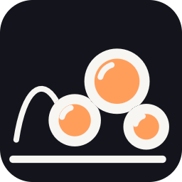 |  | 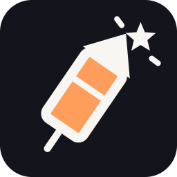 |  |  |
| برق (bolt) | كرات صغيرة (mini) | فقاعة (bubble) | ألعاب نارية (firework) | قصاصات (confetti) | نطّاطة (bouncy) |
|  | 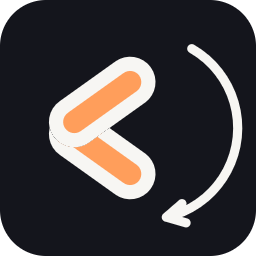 |  |  |  |  |
| ليزر (laser) | بوميرانغ (boomerang) | ماء (glob) | صاروخ (rocket) | صاعقة (lightning) | دلّة (dallah) |
| 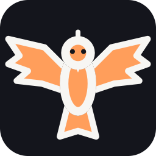 | 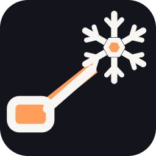 |  | 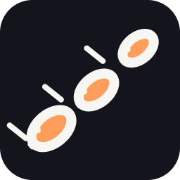 | 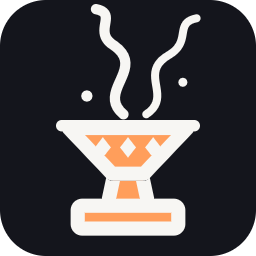 | 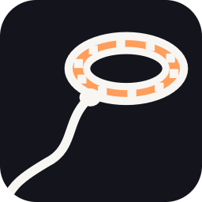 |
| الصقر (falcon) | الثلج (freeze) | الثقب الأسود (blackhole) | رشاش التمر (dates) | المبخرة (bakhoor) | حبل الشماغ (lasso) |
| 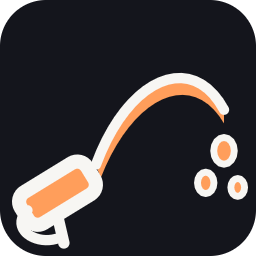 | 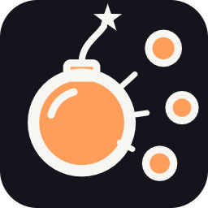 |  |  | | |
| خرطوم الماء (hose) | القنبلة العنقودية (cluster) | المغناطيس (magnet) | الدرع (shield) | | |

## المحتويات

```
weapons/                       مشروع Godot صغير حول الإضافة (داخل مستودع أصول عبودين)
├── project.godot
├── addons/aboden_blaster/     ← هذا ما تنسخه إلى لعبتك
│   ├── blaster.gd             AbodenBlaster: كل الأسلحة
│   ├── shot_catalog.gd        AbodenShotCatalog: الأسماء والرموز والتصنيف والأرقام (المصدر الوحيد)
│   ├── shot_looks.gd          AbodenShotLooks: مجسمات ومواد الكرات الصغيرة والفقاعات والبوميرانغ
│   ├── shot_crowd.gd          رسم الكرات الصغيرة والفقاعات بدفعات MultiMesh
│   ├── shot_icons.gd          AbodenShotIcons: رسم الأيقونات المتجهة
│   ├── blaster_audio.gd       AbodenBlasterAudio: مشغّل الأصوات المدمج
│   ├── plugin.cfg, plugin.gd  تعريف الإضافة (اختياري)
│   ├── military/              الحزمة العسكرية: AbodenMilitaryLauncher وكتالوجها ومساراتها ومؤثراتها وسفينتها (docs/MILITARY.md)
│   ├── icons/<id>.png         الأيقونات المخبوزة (256 بكسل)
│   ├── sounds/*.wav           91 ملف صوت (الجديدة من tools/gen_sounds.py)
│   ├── looks/fur.png          نسيج كرة الفرو
│   └── tools/bake_icons.gd    خبز الأيقونات من جديد
├── demo/                      مشهد العرض وصانع اللقطات، ومختبر الأسلحة للويب (demo/lab/)
├── tests/run_tests.gd         الاختبارات (والعسكرية: tests/run_military_tests.gd)
├── tools/                     مولّدات الوثائق (gen_docs.py) والأصوات (gen_sounds.py)
└── docs/                      الفهرس وصفحات الأسلحة واللقطات والأيقونات
```

## الاستعمال في لعبة جديدة: 5 خطوات

1. **انسخ** مجلد `addons/aboden_blaster/` إلى `res://addons/` في لعبتك. يمكنك تفعيل الإضافة من Project Settings ← Plugins لتظهر `AbodenBlaster` في نافذة إضافة العقد، والتفعيل اختياري.
2. **أضف العقدة** حيث يعيش عالم لعبتك: `var blaster := AbodenBlaster.new()` ثم `world.add_child(blaster)`. كل المواقع والاتجاهات بإحداثيات هذه العقدة المحلية، فالأسهل أن تكون ابنًا لجذر العالم بتحويل الهوية.
3. **صِلها بالمضيف:** `blaster.setup(self)`. المضيف أي `Node` تعرّف فيه ما تحتاجه فقط من نداءات الجدول أدناه، وكلها اختيارية. بلا مضيف أصلًا تطير الأسلحة وتُرسم وتُسمع وترتطم بالأرض (y = 0).
4. **اختر السلاح وأطلق:** `blaster.style = "rocket"` ثم `blaster.fire("right", origin, dir)` أو `blaster.fire_at(origin, target_point)`. لكل يد مؤقّت خاص، فالضغط المستمر يطلق بمعدل `cool`.
5. **حرّكها كل إطار:** `blaster.step(delta)` في `_process`، أو `blaster.auto_step = true`. للاستماع: `blaster.shot_hit.connect(...)`.

## واجهة المضيف

كل نداء اختياري. تتحقق الحزمة منه بـ `has_method`، وإن غاب استعملت القيمة الافتراضية. المواقع كلها بإحداثيات `AbodenBlaster` المحلية ("وحدات اللعبة").

| النداء | ماذا يفعل | الافتراضي |
|---|---|---|
| `blaster_scale() -> float` | كم وحدة لعبة في المتر: يضرب السرعات والمدى والجاذبية والبحث | `1.0` |
| `blaster_look_scale() -> float` | حجم القذائف والشرر والانفجارات إن أردته مختلفًا عن المدى | `blaster_scale()` |
| `blaster_targets() -> Array` | الأهداف الناعمة: `[{ref` أو `id, p: Vector3, r: float, color?, burst?}]`. `ref`/`id` هوية ثابتة للتتبع، `color` لون فرقعتها، `burst: false` بلا فرقعة | لا أهداف |
| `blaster_hit(target, dir) -> bool` | وصلت قذيفة إلى هدف ناعم (القاموس نفسه الذي أعطيته): هل احتُسبت؟ احذفه من قائمتك إن «مات» | `true` |
| `blaster_stage() -> Node3D` | مسرح: شبكاته المخفية (`MeshInstance3D` بـ `layers = 0`) أهداف للتوجيه والتسلسل، وكل شبكاته المرئية تُختبر بالأشعة؛ ودالته `shoot(obj, point, dir) -> bool` تقرر الإصابة | الخاصية `stage` |
| `shot_fan() -> int` (في المسرح أو المضيف) | عدد الطلقات في المرة (1..5): الطلقة الثلاثية تدوّر ±0.11 راديان | `1` |
| `blaster_floor_y() -> float` | ارتفاع الأرض؛ `-INF` بلا أرض | الخاصية `floor_y` (0) |
| `blaster_collide(p, v, r[, prev]) -> Dictionary` | جدران العالم: `{hit: سرعة الارتطام أو true, p, v, n?}` أو `{}` | لا جدران |
| `blaster_eye() -> Vector3` | عين اللاعب (لعودة النطّاطة، وتحدي «فوق رأسك») | كاميرا الشاشة، وإلا 1.6 م |
| `blaster_roam() -> bool` | لا جدران حولك: الكرات النطّاطة ترجع إذا ابتعدت 6 م | `false` |
| `blaster_hand(hand) -> Vector3` | أين اليد الآن (يعود إليها البوميرانغ) | مكان الإطلاق |
| `blaster_sfx(name, k, pos)` | شغّل صوتًا بنفسك | المشغّل المدمج `AbodenBlasterAudio` |
| `blaster_buzz(hand, amp, ms)` | اهتزاز اليد | لا شيء |
| `blaster_credit(kind, n)` | سلاح `kind` أصاب `n` أهداف (للنقاط) | لا شيء |
| `blaster_challenge(id, value)` | تقدّم تحدٍّ (`AbodenShotCatalog.CHALLENGES` يقول هل `value` يُجمع أم يؤخذ الأفضل) | لا شيء |
| `blaster_freeze(target, seconds)` | (v1.2، الثلج) جمّد الهدف الناعم `seconds` ثانية بدل الإصابة | يُصاب |
| `blaster_slow(target, factor, seconds)` | (v1.2، المبخرة) سرعة الهدف × `factor` مدة `seconds` (يتجدد كل 0.25 ث داخل الدخان) | الدخان شكل فقط |
| `blaster_pull(target, to, strength)` | (v1.2) حرّك الهدف نحو `to` بـ `strength` وحدة في هذا النداء (سرعة × dt): الثقب الأسود والمغناطيس، وحبل الشماغ بدل الإصابة | الجذب شكل فقط؛ الحبل يصيب |
| `blaster_push(target, velocity)` | (v1.2، الخرطوم) أعطِ الهدف هذه السرعة بعيدًا عنك بدل الإصابة | `blaster_pull` إلى نقطة خلفه، وإلا يُصاب |
| `blaster_threats() -> Array` | (v1.2) قذائف الخصم `[{ref` أو `id, p, r?, metal?}]` للدرع والمغناطيس | لا قذائف |
| `blaster_block(threat, at) -> bool` | (v1.2) أوقف الدرع أو المغناطيس هذه القذيفة عند `at`: دمّرها | لا شيء |

**المسرح:** أي `Node3D` فيه شبكات. الشبكة المخفية بـ `layers = 0` هدف، والمرئية جسم صلب، و`shoot()` يقرر لكل منهما هل احتُسبت الإصابة. الأشعة لا تتوقف عند النصوص (`TextMesh` وأبناء `Label3D`) ولا عند ما في المجموعة `blaster_ignore` أو عليه meta بهذا الاسم (خطوط إرشاد، شباك، زينة).

**الواجهة البرمجية:** `style`، `fire(hand, origin, dir) -> bool`، `fire_at(origin, target_point, hand := "right") -> bool`، `step(dt)`، `auto_step`، `clear()`، `shot_count()`، `set_seed(n)`، `sound_on`، الإشارتان `shot_fired(kind, hand)` و`shot_hit(kind, target)`، و`ray_stage(stage, from, dir, far)` للاستعمال الحر.

`fire_at` يصوّب الاتجاه نحو النقطة دون تعويض للجاذبية، ويحفظ النقطة على كل قذيفة في `s["aim"]` لتستعملها لاحقًا أسلحة تطير إلى نقطة (انظر «الحزم القادمة» في الفهرس).

## محوّل بسيط (مثال)

```gdscript
extends Node3D
## My game's host for the blaster: enemies are soft targets, the arena's walls are a stage.

@onready var blaster := AbodenBlaster.new()
@onready var arena: Node3D = $Arena  # walls (visible meshes) + hidden layers = 0 hit spheres
var enemies: Array = []  # each: {ref: Node3D, p: Vector3, r: 0.3, color: "ff5c8a"}


func _ready() -> void:
	add_child(blaster)
	blaster.setup(self)
	blaster.auto_step = true
	blaster.style = "rocket"
	blaster.shot_hit.connect(func(kind: String, target) -> void: print(kind, " hit ", target))


func _unhandled_input(e: InputEvent) -> void:
	if e is InputEventMouseButton and e.pressed:
		var cam := get_viewport().get_camera_3d()
		var to := cam.project_ray_origin(e.position) + cam.project_ray_normal(e.position) * 10.0
		blaster.fire_at(cam.global_position + Vector3.DOWN * 0.2, to)


func blaster_targets() -> Array:
	for t in enemies:
		t.p = (t.ref as Node3D).position  # keep them current
	return enemies


func blaster_hit(t: Dictionary, _dir: Vector3) -> bool:
	(t.ref as Node3D).queue_free()
	enemies.erase(t)
	return true


func blaster_stage() -> Node3D:
	return arena


func blaster_credit(kind: String, n: int) -> void:
	$Score.add(n * 10)
```

المشهد `demo/blaster_demo.tscn` مثال كامل يعمل: مسرح بأهداف مخفية تحت كرات مرئية (الكرات في `blaster_ignore`)، وأهداف ناعمة وردية يعطيها المضيف.

## إضافة سلاح جديد

القائمة الكاملة في [`docs/CATALOG.md` ← إضافة سلاح جديد](docs/CATALOG.md#إضافة-سلاح-جديد)، والقالب في [`docs/weapons/_TEMPLATE.md`](docs/weapons/_TEMPLATE.md). باختصار:

1. خذ رمزه: من `RESERVED` إن كان محجوزًا، وإلا `AbodenShotCatalog.next_code()`.
2. أضف مدخله إلى `ORDER` و`SHOTS` ومعاملاته إلى `SHOT_STYLE` في `shot_catalog.gd`.
3. مجسمه في `_shot_node()` وموادّه في `MATS`، وسلوكه في `_move()` و`_trail()` و`_on_pop()` و`_on_solid()` و`_finish()` في `blaster.gd`، أو دالة فورية تُستدعى من `fire()` للأشعة.
4. أيقونته في `shapes()` و`IDS` في `shot_icons.gd`، ثم اخبزها. صوته في `sounds/` و`AbodenBlasterAudio.SFX`.
5. اختباره في `tests/run_tests.gd`، ولقطته بخطة في `SHOOT` في `demo/blaster_demo.gd`، وصفحته وصف الفهرس، وسطر في السجل.

## مختبر الأسلحة (الويب) — Weapon lab (web)

صفحة واحدة في المتصفح لتجربة كل سلاح، للجوال أولًا (عمودي وأفقي) وتعمل بالفأرة أيضًا. ستُستضاف على **https://3wasfnjd.github.io/AR-Aboden/blaster-lab/**.

| | | |
|---|---|---|
| 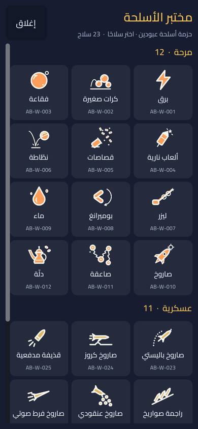 | 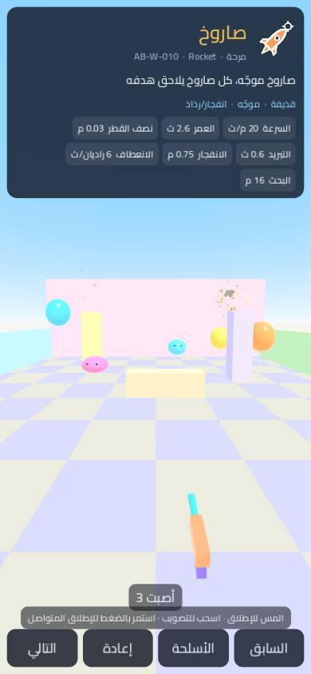 | 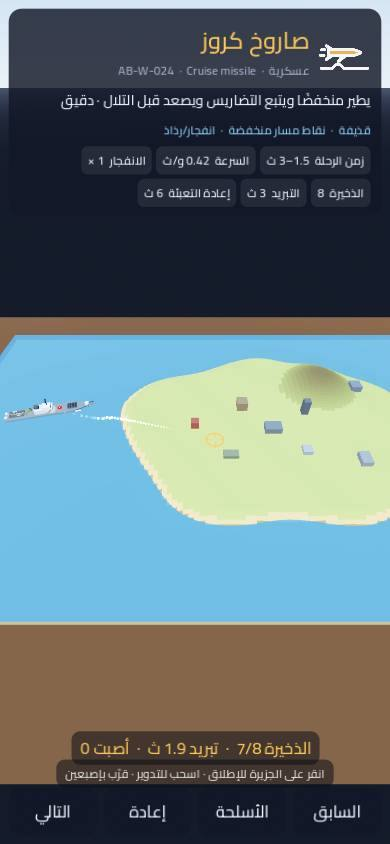 |
| قائمة الأسلحة | صاروخ (`AB-W-010`) في الساحة | صاروخ كروز (`AB-W-024`) على الجزيرة |

- **القائمة** تُقرأ من الكتالوجين وقت التشغيل (`AbodenShotCatalog.SHOTS` و`AbodenMilitaryCatalog.WEAPONS`) مجمّعة حسب الحزمة (مرحة / عسكرية)، فكل سلاح يُضاف إلى أحدهما يظهر وحده. البطاقة: الاسم بالعربية والإنجليزية والرمز والوصف وأرقام الكتالوج، وأزرار السابق والتالي والقائمة والإعادة (لمس البطاقة يطوي التفاصيل).
- **الأسلحة المرحة:** ساحة ملوّنة بجدران (مسرح ترتد عنه القذائف) وبالونات وكرات هلامية تتحرك وتعود بعد الفرقعة. المس للإطلاق، اسحب للتصويب، واستمر بالضغط للإطلاق المتواصل. الأهداف تنفّذ `blaster_targets` و`blaster_hit` و`blaster_stage` و`blaster_floor_y` و`blaster_eye` و`blaster_hand`، والنداءات الاختيارية للأسلحة القادمة: `blaster_slow(target, factor, seconds)` و`blaster_pull(target, to, strength)` و`blaster_freeze(target, seconds)` و`blaster_push(target, velocity)`.
- **الأسلحة العسكرية:** طاولة عليها جزيرة وبحر وسفينة الإطلاق ومبانٍ صغيرة تسقط بالانفجار. انقر على الجزيرة للإطلاق، اسحب للتدوير، قرّب بإصبعين (أو بعجلة الفأرة). الذخيرة والتبريد ظاهران، و«إعادة» تملأ الذخيرة وتعيد المباني.
- **الرابط:** `?w=AB-W-010` يفتح السلاح مباشرة، و`?lang=en` للواجهة الإنجليزية (العربية افتراضية بخط Cairo، رخصته OFL في `demo/lab/fonts/`). الصفحة تحدّث الرابط حين تغيّر السلاح، وتكتب حالتها في `window.abodenLab`.

```sh
# على الكمبيوتر (نفس الخيارات كوسائط)
godot --path . res://demo/lab/weapon_lab.tscn -- --w=AB-W-024 --lang=en
# تصدير الويب (القالب Web: بدون خيوط ولا PWA، عارض Compatibility) إلى build/web-lab/
mkdir -p build/web-lab && touch build/.gdignore && godot --headless --path . --export-release "Web" build/web-lab/index.html
# تجربة محلية (لا تحتاج ترويسات عزل)
python3 -m http.server 8000 -d build/web-lab   # ثم http://localhost:8000/?w=AB-W-010
```

الميزة `blaster_lab` في القالب تجعل المختبر المشهد الرئيسي للويب (`run/main_scene.blaster_lab` في `project.godot`)، وتشغيل المشروع على الكمبيوتر يبقى على `demo/blaster_demo.tscn`. التصدير يستثني `tests/` و`tools/` و`docs/`. الحجم نحو 38 م.ب (المحرك `index.wasm` ‏37.7 م.ب، نحو 9 م.ب مضغوطًا، وبيانات المختبر `index.pck` ‏0.74 م.ب).

## الأوامر

```sh
# الاختبارات (تطبع PASS/FAIL وتخرج بـ 1 عند أي فشل)
godot --headless --path . -s res://tests/run_tests.gd
# العرض التفاعلي (نقرة: إطلاق، 1..0 - =: السلاح، Tab: التالي، F: الطلقة الثلاثية)
godot --path . res://demo/blaster_demo.tscn
# لقطة لسلاح واحد / لكل الأسلحة (1280x720)
xvfb-run -a godot --rendering-driver opengl3 --path . res://demo/blaster_demo.tscn -- --style=rocket --screenshot=res://docs/shots/rocket.png
xvfb-run -a godot --rendering-driver opengl3 --path . res://demo/blaster_demo.tscn -- --all=res://docs/shots
# خبز الأيقونات (والنسخة على بطاقة داكنة للوثائق)
godot --headless --path . -s res://addons/aboden_blaster/tools/bake_icons.gd -- --docs=res://docs/icons
```

أول تشغيل لمشروع جديد يحتاج استيراد الملفات: `godot --headless --path . --import`.

## ملاحظات

- **الأداء:** 48 قذيفة كحد أقصى (الأقدم يُستبدل، وحبات البن وقطرات الخرطوم تأخذ الأماكن الشاغرة فقط)، و320 شرارة، و24 قوسًا، و20 كرة نطّاطة. الشرر والأشعة والكرات الصغيرة كلها بدفعات MultiMesh.
- **العُرض:** متوافق مع GL Compatibility (Quest وغيره). مادة الكرة الهلامية فيها `light_dir` و`light_color` و`light_intensity` تضبطها من شمسك عبر `AbodenShotLooks.body_material("jelly")`.
- **الحقوق:** الكود والأيقونات والأصوات والنسيج من عبودين قيمز (Aboden Games)، وكلها محفوظة.
