# فهرس الأسلحة — حزمة أسلحة عبودين (Aboden Blaster Kit)

المرجع الدائم لكل أسلحة الحزمة. لكل سلاح **رمز دائم** `AB-W-NNN` لا يتغير ولا يُعاد استخدامه، وصفحة كاملة في `docs/weapons/`. الأرقام كلها من `addons/aboden_blaster/shot_catalog.gd` (المصدر الوحيد للحقيقة)، والأطوال بالمتر قبل الضرب في `blaster_scale()`.

- [الجدول الملخص](#الجدول-الملخص) · [التصنيف](#التصنيف-taxonomy) · [محاور الوسوم](#محاور-الوسوم-tag-axes) · [إضافة سلاح](#إضافة-سلاح-جديد) · [قائمة الأفكار](#قائمة-الأفكار--roadmap)
- القالب: [`weapons/_TEMPLATE.md`](weapons/_TEMPLATE.md) · السجل: [`CHANGELOG.md`](CHANGELOG.md) · الدليل: [`../README.md`](../README.md)

## الجدول الملخص

يمكن فرز هذا الجدول أو تصفيته بأي عمود (انسخه إلى جدول بيانات، أو ابحث بالمعرّف الإنجليزي مثل `homing` أو `splash`).

| الرمز | الأيقونة | الاسم | المعرّف | الحزمة | العائلة | الإيصال | المسار | الإصابة | الدور | الفئة | الحالة | الإصدار |
|---|---|---|---|---|---|---|---|---|---|---|---|---|
| [`AB-W-001`](weapons/AB-W-001_bolt.md) |  | **برق** (Bolt) | `bolt` | مرحة | قذيفة مباشرة | قذيفة (projectile) | مستقيم (straight) | هدف واحد (single) | هجوم (attack) | 0 أساسي (Starter) | مستقر | v1.0 |
| [`AB-W-002`](weapons/AB-W-002_mini.md) |  | **كرات صغيرة** (Mini Ball) | `mini` | مرحة | باليستية، ارتداد/نطّ | قذيفة (projectile) | قوسي (ballistic) | ارتداد (bounce) | هجوم (attack) | 0 أساسي (Starter) | مستقر | v1.0 |
| [`AB-W-003`](weapons/AB-W-003_bubble.md) |  | **فقاعة** (Bubble) | `bubble` | مرحة | قذيفة مباشرة | قذيفة (projectile) | طافٍ (floating) | هدف واحد (single) | هجوم (attack) | 0 أساسي (Starter) | مستقر | v1.0 |
| [`AB-W-004`](weapons/AB-W-004_firework.md) |  | **ألعاب نارية** (Firework) | `firework` | مرحة | باليستية، منطقة تأثير/انفجار | قذيفة (projectile) | قوسي (ballistic) | انفجار/رذاذ (splash) | هجوم (attack) | 0 أساسي (Starter) | مستقر | v1.0 |
| [`AB-W-005`](weapons/AB-W-005_confetti.md) |  | **قصاصات** (Confetti) | `confetti` | مرحة | رشّ/متعدد، باليستية | قذيفة (projectile) | قوسي (ballistic) | هدف واحد (single) | هجوم (attack) | 1 سهل (Easy) | مستقر | v1.0 |
| [`AB-W-006`](weapons/AB-W-006_bouncy.md) |  | **نطّاطة** (Bouncy) | `bouncy` | مرحة | ارتداد/نطّ، باليستية | قذيفة (projectile) | قوسي (ballistic) | ارتداد (bounce) | هجوم (attack) | 1 سهل (Easy) | مستقر | v1.0 |
| [`AB-W-007`](weapons/AB-W-007_laser.md) |  | **ليزر** (Laser) | `laser` | مرحة | فورية/شعاع | شعاع فوري (hitscan) | مستقيم (straight) | اختراق (pierce) | هجوم (attack) | 2 متوسط (Medium) | مستقر | v1.0 |
| [`AB-W-008`](weapons/AB-W-008_boomerang.md) |  | **بوميرانغ** (Boomerang) | `boomerang` | مرحة | مرتدّة/عائدة | قذيفة (projectile) | عائد (returning) | اختراق (pierce) | هجوم (attack) | 2 متوسط (Medium) | مستقر | v1.0 |
| [`AB-W-009`](weapons/AB-W-009_glob.md) |  | **ماء** (Water) | `glob` | مرحة | باليستية، منطقة تأثير/انفجار | قذيفة (projectile) | قوسي (ballistic) | انفجار/رذاذ (splash) | هجوم (attack) | 3 متقدم (Advanced) | مستقر | v1.0 |
| [`AB-W-010`](weapons/AB-W-010_rocket.md) |  | **صاروخ** (Rocket) | `rocket` | مرحة | موجّهة، منطقة تأثير/انفجار | قذيفة (projectile) | موجّه (homing) | انفجار/رذاذ (splash) | هجوم (attack) | 3 متقدم (Advanced) | مستقر | v1.0 |
| [`AB-W-011`](weapons/AB-W-011_lightning.md) |  | **صاعقة** (Lightning) | `lightning` | مرحة | فورية/شعاع | شعاع فوري (hitscan) | موجّه (homing) | تسلسل (chain) | هجوم (attack) | 4 نخبة (Elite) | مستقر | v1.0 |
| [`AB-W-012`](weapons/AB-W-012_dallah.md) |  | **دلّة** (Dallah) | `dallah` | مرحة | باليستية، رشّ/متعدد | قذيفة (projectile) | قوسي (ballistic) | اختراق (pierce) | هجوم (attack) | 4 نخبة (Elite) | مستقر | v1.0 |
| [`AB-W-013`](weapons/AB-W-013_falcon.md) |  | **الصقر** (Falcon) | `falcon` | مرحة | موجّهة، مرتدّة/عائدة | قذيفة (projectile) | موجّه (homing) | هدف واحد (single) | هجوم (attack) | 3 متقدم (Advanced) | مستقر | v1.2 |
| [`AB-W-014`](weapons/AB-W-014_freeze.md) |  | **الثلج** (Freeze Ray) | `freeze` | مرحة | فورية/شعاع | شعاع فوري (hitscan) | مستقيم (straight) | هدف واحد (single) | إسناد (support) | 2 متوسط (Medium) | مستقر | v1.2 |
| [`AB-W-015`](weapons/AB-W-015_blackhole.md) |  | **الثقب الأسود** (Black Hole) | `blackhole` | مرحة | منطقة تأثير/انفجار | قذيفة (projectile) | مستقيم (straight) | انفجار/رذاذ (splash) | هجوم (attack) | 4 نخبة (Elite) | مستقر | v1.2 |
| [`AB-W-016`](weapons/AB-W-016_dates.md) |  | **رشاش التمر** (Date Blaster) | `dates` | مرحة | قذيفة مباشرة، رشّ/متعدد | قذيفة (projectile) | قوسي (ballistic) | هدف واحد (single) | هجوم (attack) | 1 سهل (Easy) | مستقر | v1.2 |
| [`AB-W-017`](weapons/AB-W-017_bakhoor.md) |  | **المبخرة** (Bakhoor) | `bakhoor` | مرحة | منطقة تأثير/انفجار، باليستية | قذيفة (projectile) | قوسي (ballistic) | منطقة باقية (lingering) | إسناد (support) | 2 متوسط (Medium) | مستقر | v1.2 |
| [`AB-W-018`](weapons/AB-W-018_lasso.md) |  | **حبل الشماغ** (Shemagh Lasso) | `lasso` | مرحة | باليستية، مرتدّة/عائدة | قذيفة (projectile) | قوسي (ballistic) | هدف واحد (single) | إسناد (support) | 2 متوسط (Medium) | مستقر | v1.2 |
| [`AB-W-019`](weapons/AB-W-019_hose.md) |  | **خرطوم الماء** (Water Hose) | `hose` | مرحة | رشّ/متعدد، باليستية | قذيفة (projectile) | قوسي (ballistic) | هدف واحد (single) | إسناد (support) | 1 سهل (Easy) | مستقر | v1.2 |
| [`AB-W-020`](weapons/AB-W-020_cluster.md) |  | **القنبلة العنقودية** (Cluster Bomb) | `cluster` | مرحة | منطقة تأثير/انفجار، رشّ/متعدد | قذيفة (projectile) | قوسي (ballistic) | انفجار/رذاذ (splash) | هجوم (attack) | 3 متقدم (Advanced) | مستقر | v1.2 |
| [`AB-W-021`](weapons/AB-W-021_magnet.md) |  | **المغناطيس** (Magnet) | `magnet` | مرحة | منطقة تأثير/انفجار | قذيفة (projectile) | مستقيم (straight) | منطقة باقية (lingering) | إسناد (support) | 3 متقدم (Advanced) | مستقر | v1.2 |
| [`AB-W-022`](weapons/AB-W-022_shield.md) |  | **الدرع** (Shield Bubble) | `shield` | مرحة | دفاع/حماية | منطقة (area) | مع اليد (held) | منطقة باقية (lingering) | دفاع/اعتراض (defence) | 2 متوسط (Medium) | مستقر | v1.2 |

### المعرض

| | | | |
|---|---|---|---|
| [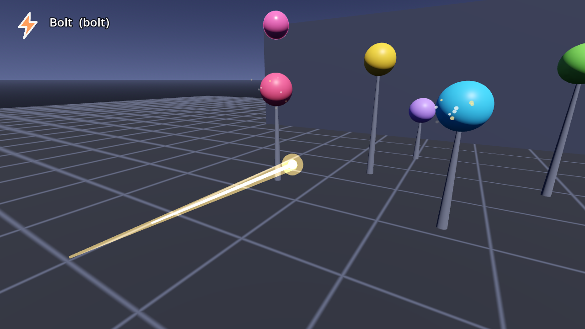](weapons/AB-W-001_bolt.md) | [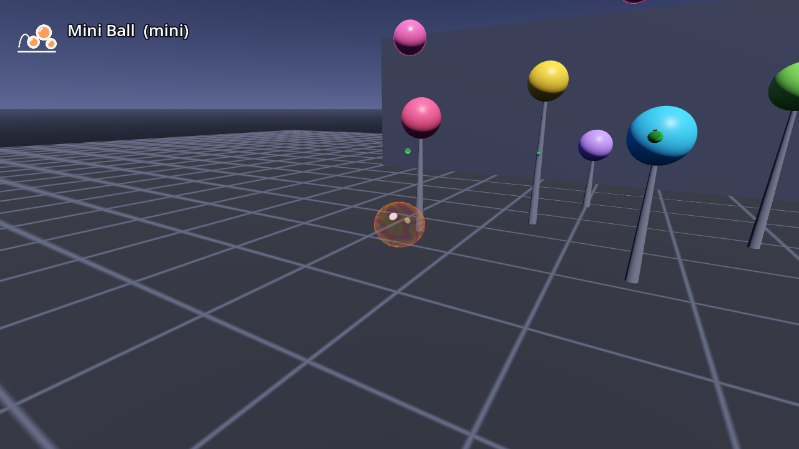](weapons/AB-W-002_mini.md) |  | [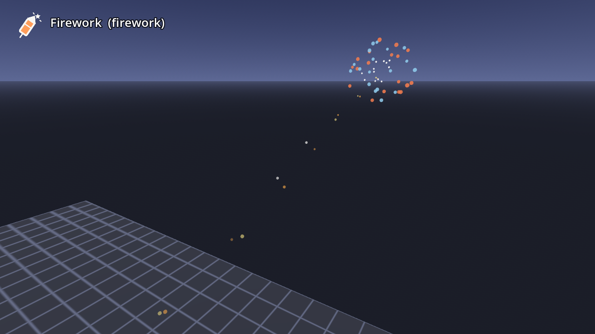](weapons/AB-W-004_firework.md) |
| `AB-W-001` برق (Bolt) | `AB-W-002` كرات صغيرة (Mini Ball) | `AB-W-003` فقاعة (Bubble) | `AB-W-004` ألعاب نارية (Firework) |
|  |  | [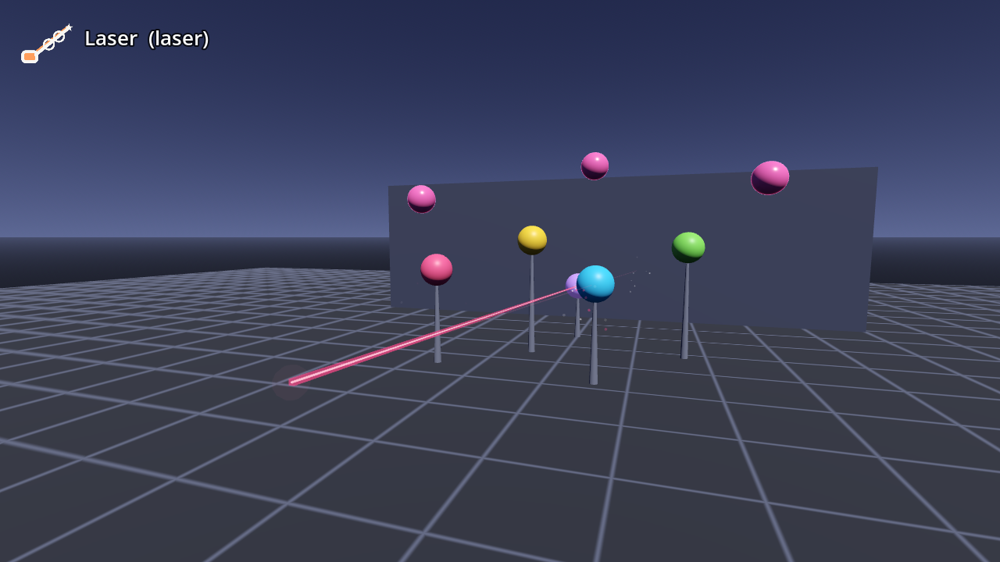](weapons/AB-W-007_laser.md) | [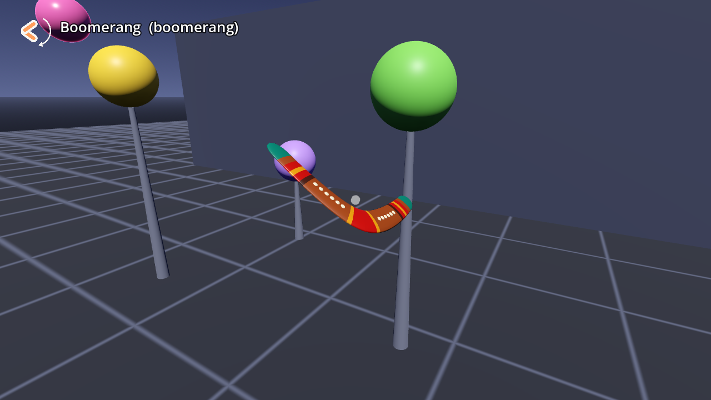](weapons/AB-W-008_boomerang.md) |
| `AB-W-005` قصاصات (Confetti) | `AB-W-006` نطّاطة (Bouncy) | `AB-W-007` ليزر (Laser) | `AB-W-008` بوميرانغ (Boomerang) |
| [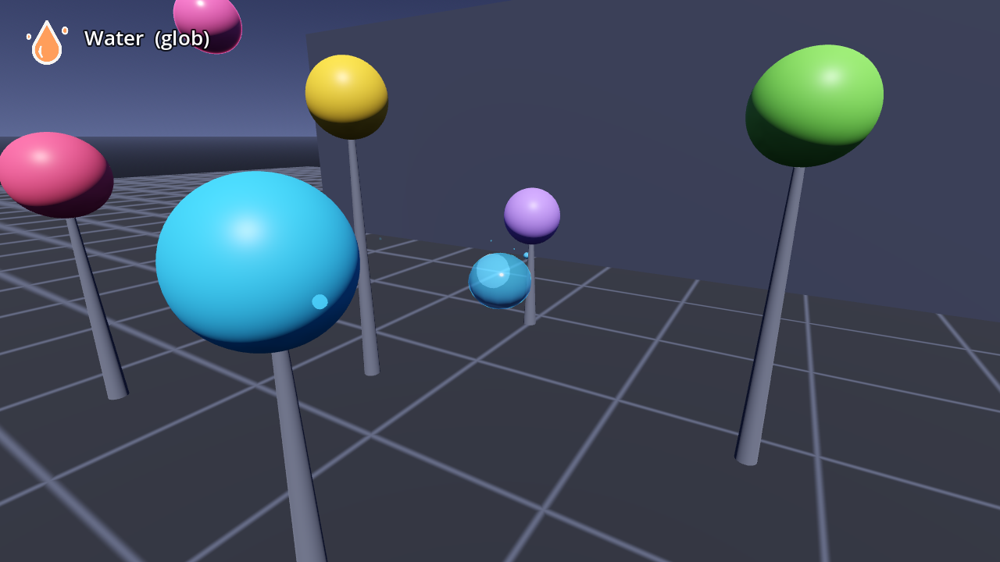](weapons/AB-W-009_glob.md) |  |  | [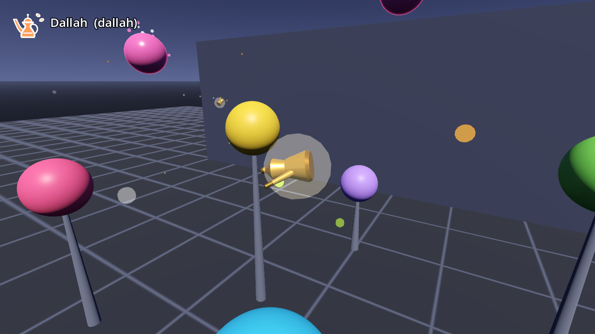](weapons/AB-W-012_dallah.md) |
| `AB-W-009` ماء (Water) | `AB-W-010` صاروخ (Rocket) | `AB-W-011` صاعقة (Lightning) | `AB-W-012` دلّة (Dallah) |
| [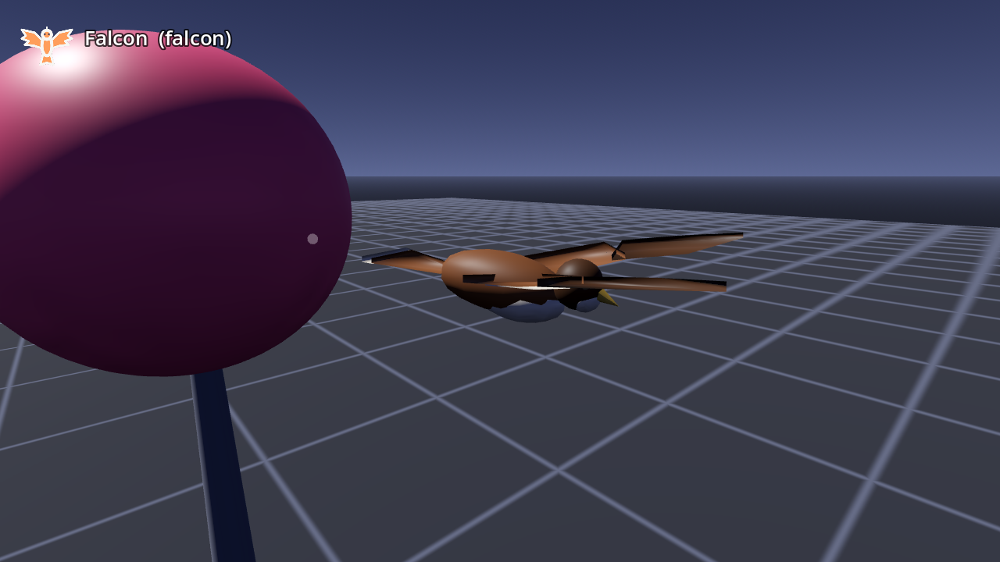](weapons/AB-W-013_falcon.md) | [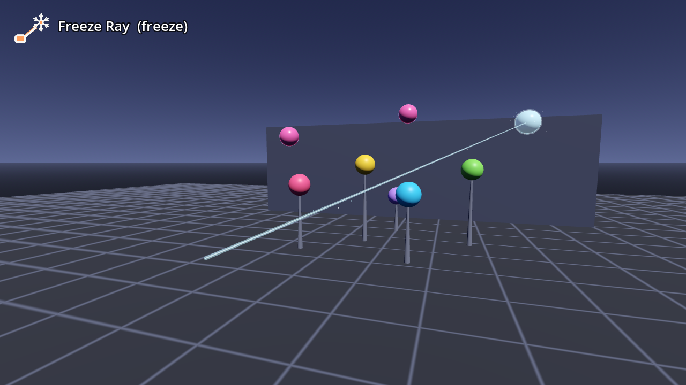](weapons/AB-W-014_freeze.md) | [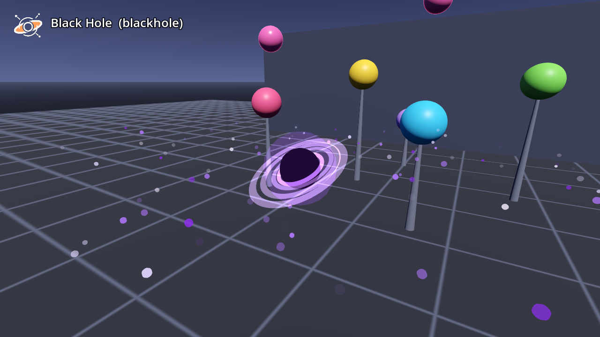](weapons/AB-W-015_blackhole.md) | [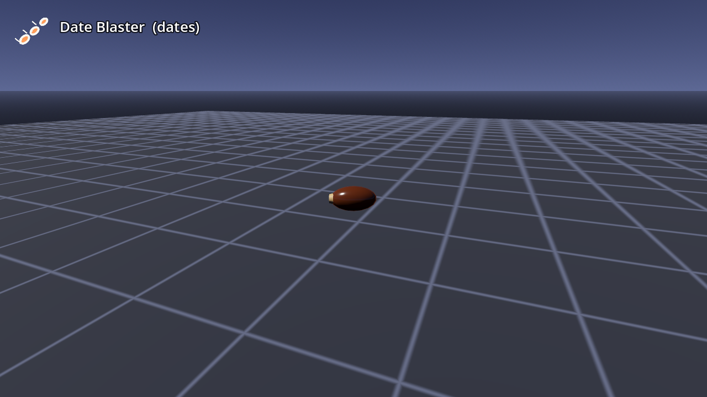](weapons/AB-W-016_dates.md) |
| `AB-W-013` الصقر (Falcon) | `AB-W-014` الثلج (Freeze Ray) | `AB-W-015` الثقب الأسود (Black Hole) | `AB-W-016` رشاش التمر (Date Blaster) |
| [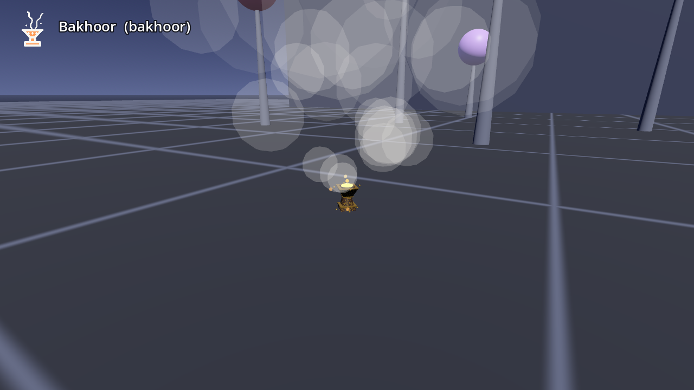](weapons/AB-W-017_bakhoor.md) |  | [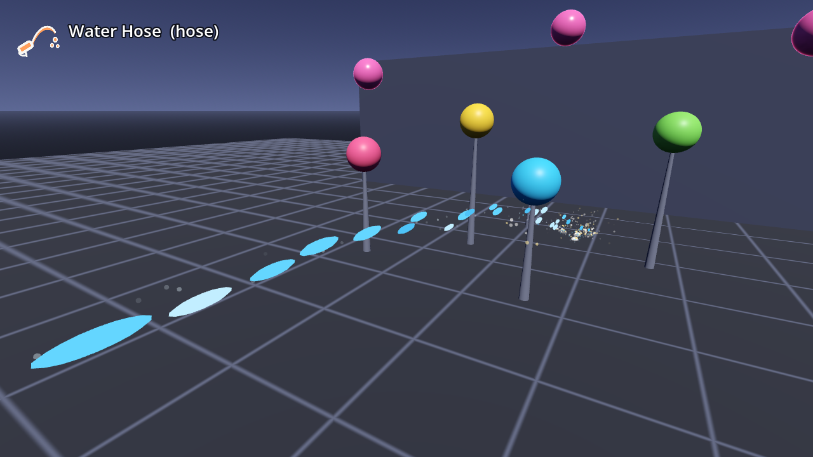](weapons/AB-W-019_hose.md) |  |
| `AB-W-017` المبخرة (Bakhoor) | `AB-W-018` حبل الشماغ (Shemagh Lasso) | `AB-W-019` خرطوم الماء (Water Hose) | `AB-W-020` القنبلة العنقودية (Cluster Bomb) |
| [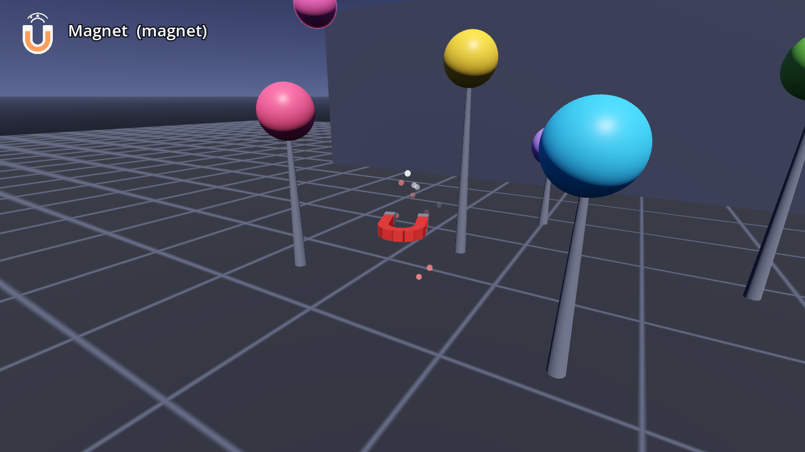](weapons/AB-W-021_magnet.md) | [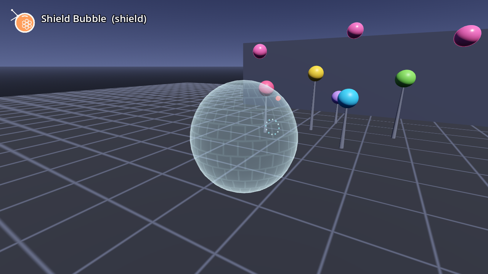](weapons/AB-W-022_shield.md) |   |   |
| `AB-W-021` المغناطيس (Magnet) | `AB-W-022` الدرع (Shield Bubble) |   |   |

## التصنيف (taxonomy)

**العائلة** (category، الحقل `tags` في الكتالوج) تصف طبيعة السلاح، وقد يكون للسلاح أكثر من عائلة. تعريفات العائلات في `AbodenShotCatalog.CATEGORIES`.

| العائلة | المعرّف | التعريف | الأسلحة |
|---|---|---|---|
| قذيفة مباشرة | `direct` | قذيفة لها جسم تطير في خط شبه مستقيم وتتوقف عند أول إصابة. | [برق](weapons/AB-W-001_bolt.md)، [فقاعة](weapons/AB-W-003_bubble.md)، [رشاش التمر](weapons/AB-W-016_dates.md) |
| باليستية | `ballistic` | قذيفة تتأثر بالجاذبية (`grav` > 0) فترسم قوسًا. | [كرات صغيرة](weapons/AB-W-002_mini.md)، [ألعاب نارية](weapons/AB-W-004_firework.md)، [قصاصات](weapons/AB-W-005_confetti.md)، [نطّاطة](weapons/AB-W-006_bouncy.md)، [ماء](weapons/AB-W-009_glob.md)، [دلّة](weapons/AB-W-012_dallah.md)، [المبخرة](weapons/AB-W-017_bakhoor.md)، [حبل الشماغ](weapons/AB-W-018_lasso.md)، [خرطوم الماء](weapons/AB-W-019_hose.md) |
| فورية/شعاع | `instant` | لا قذيفة: الإصابة تُحسب في لحظة الإطلاق على امتداد شعاع أو قوس (hitscan)، ويُرسم الخط ثم يخبو. | [ليزر](weapons/AB-W-007_laser.md)، [صاعقة](weapons/AB-W-011_lightning.md)، [الثلج](weapons/AB-W-014_freeze.md) |
| منطقة تأثير/انفجار | `area` | تؤذي كل ما في نصف قطر حول نقطة الانفجار أو الرذاذ (`pop_radius`). | [ألعاب نارية](weapons/AB-W-004_firework.md)، [ماء](weapons/AB-W-009_glob.md)، [صاروخ](weapons/AB-W-010_rocket.md)، [الثقب الأسود](weapons/AB-W-015_blackhole.md)، [المبخرة](weapons/AB-W-017_bakhoor.md)، [القنبلة العنقودية](weapons/AB-W-020_cluster.md)، [المغناطيس](weapons/AB-W-021_magnet.md) |
| موجّهة | `homing` | تختار هدفها بنفسها وتتجه إليه (بحث + التفاف) أو تقفز إليه. | [صاروخ](weapons/AB-W-010_rocket.md)، [الصقر](weapons/AB-W-013_falcon.md) |
| مرتدّة/عائدة | `returning` | تعود إلى اليد التي رمتها بعد رحلة محددة. | [بوميرانغ](weapons/AB-W-008_boomerang.md)، [الصقر](weapons/AB-W-013_falcon.md)، [حبل الشماغ](weapons/AB-W-018_lasso.md) |
| رشّ/متعدد | `spray` | تطلق أكثر من جسم في الطلقة الواحدة أو ترشّ قذائف ثانوية أثناء الطيران. | [قصاصات](weapons/AB-W-005_confetti.md)، [دلّة](weapons/AB-W-012_dallah.md)، [رشاش التمر](weapons/AB-W-016_dates.md)، [خرطوم الماء](weapons/AB-W-019_hose.md)، [القنبلة العنقودية](weapons/AB-W-020_cluster.md) |
| ارتداد/نطّ | `bouncing` | ترتد عن الأرض والأجسام وتكمل بدل أن تتوقف. | [كرات صغيرة](weapons/AB-W-002_mini.md)، [نطّاطة](weapons/AB-W-006_bouncy.md) |
| دفاع/حماية | `defence` | تحمي اللاعب: تصدّ قذائف الخصم التي يبلغ عنها المضيف (`blaster_threats`) بدل أن تصيب الأهداف. | [الدرع](weapons/AB-W-022_shield.md) |

## محاور الوسوم (tag axes)

إلى جانب العائلة، لكل سلاح قيمة واحدة على كل محور (الحقول `pack` و`delivery` و`trajectory` و`hit` و`role` و`tier` و`status` و`version`؛ القيم المسموحة في `AbodenShotCatalog.PACKS` و`AXES` و`TIERS` و`STATUS`). القيم المعلّمة «مخطط» محجوزة للحزم القادمة ولا يستعملها أي سلاح حاليًا؛ قيم `called` و`lofted` و`waypoints` و`vertical` و`intercept` و`falloff` و`scan` و`defence` و`support` تستعملها [الحزمة العسكرية](MILITARY.md)، وأسلحة v1.2 المرحة أول من استعمل الإيصال `area` و`lingering`، وأضافت المسار `held` والعائلة `defence`.

### الحزمة (pack)

| الحزمة | المعرّف | المعنى | الأسلحة |
|---|---|---|---|
| مرحة | `playful` | الأسلحة المرحة الملوّنة: الاثنا عشر الأولى من دحروج (v1.0) والعشرة الجديدة (v1.2). | AB-W-001 … AB-W-022 |
| عسكرية | `military` | أسلحة البارجة في «حرب البارجة» لألعاب الطاولة العسكرية المصغّرة، بمطلقها الخاص `AbodenMilitaryLauncher`. فهرسها في [`MILITARY.md`](MILITARY.md). | AB-W-023 … AB-W-040 |

المعرّفات (id) لكل حزمة في كتالوجها: `cluster` المرحة (AB-W-020، قنبلة عنقودية) و`cluster` العسكرية (AB-W-027، صاروخ عنقودي) سلاحان مختلفان؛ الفريد في الحزمة كلها هو الرمز `AB-W-NNN`.

### طريقة الإيصال (delivery)

| القيمة | المعرّف | التعريف | الأسلحة |
|---|---|---|---|
| قذيفة | `projectile` | جسم يطير في العالم خطوة بخطوة (له عمر ونصف قطر). | برق، كرات صغيرة، فقاعة، ألعاب نارية، قصاصات، نطّاطة، بوميرانغ، ماء، صاروخ، دلّة، الصقر، الثقب الأسود، رشاش التمر، المبخرة، حبل الشماغ، خرطوم الماء، القنبلة العنقودية، المغناطيس |
| شعاع فوري | `hitscan` | حساب فوري على امتداد شعاع/قوس لحظة الإطلاق. | ليزر، صاعقة، الثلج |
| منطقة | `area` | تأثير يظهر في منطقة دون قذيفة تطير (فقاعة الدرع). | الدرع |
| ضربة مُستدعاة | `called` | ضربة تُطلب على نقطة وتصل من خارج المشهد، كالغارة الجوية أو المدفعية البعيدة (الطائرة الهجومية AB-W-032). | — |

### المسار (trajectory)

| القيمة | المعرّف | التعريف | الأسلحة |
|---|---|---|---|
| مستقيم | `straight` | خط مستقيم بلا جاذبية. | برق، ليزر، الثلج، الثقب الأسود، المغناطيس |
| قوسي | `ballistic` | قوس تحت الجاذبية. | كرات صغيرة، ألعاب نارية، قصاصات، نطّاطة، ماء، دلّة، رشاش التمر، المبخرة، حبل الشماغ، خرطوم الماء، القنبلة العنقودية |
| موجّه | `homing` | يتجه إلى هدف يختاره. | صاروخ، صاعقة، الصقر |
| عائد | `returning` | يعود إلى اليد. | بوميرانغ |
| طافٍ | `floating` | يطفو ويتمايل ببطء. | فقاعة |
| مع اليد | `held` | لا يطير: يبقى أمام اليد ويتبعها (فقاعة الدرع). | الدرع |
| قوس عالٍ وعودة للغلاف | `lofted` | قوس عالٍ جدًا ثم هبوط حاد نحو النقطة، كالصاروخ الباليستي المصغّر وعودته للغلاف (الحزمة العسكرية). | — |
| نقاط مسار | `waypoints` | يتبع نقاط مسار منخفضًا فوق التضاريس، كصاروخ كروز (الحزمة العسكرية). | — |
| من الأعلى | `vertical` | يسقط من الأعلى على النقطة (خارق التحصينات AB-W-029). | — |
| اعتراض | `intercept` | يلاحق هدفًا جويًا لاعتراضه (صاروخ الدفاع الجوي AB-W-035). | — |

### نموذج الإصابة (hit model)

| القيمة | المعرّف | التعريف | الأسلحة |
|---|---|---|---|
| هدف واحد | `single` | يصيب هدفًا واحدًا ويتوقف. | برق، فقاعة، قصاصات، الصقر، الثلج، رشاش التمر، حبل الشماغ، خرطوم الماء |
| اختراق | `pierce` | يخترق أكثر من هدف ويكمل. | ليزر، بوميرانغ، دلّة |
| تسلسل | `chain` | يقفز من هدف إلى الذي يليه. | صاعقة |
| انفجار/رذاذ | `splash` | يصيب كل ما في نصف قطر عند الانفجار/الرذاذ. | ألعاب نارية، ماء، صاروخ، الثقب الأسود، القنبلة العنقودية |
| ارتداد | `bounce` | يرتد ويكمل بعد الإصابة أو الارتطام. | كرات صغيرة، نطّاطة |
| تناقص الضرر | `falloff` | انفجار كبير يقل ضرره مع البعد عن المركز (مخطط). | — |
| منطقة باقية | `lingering` | منطقة تبقى وتؤثر مدة: دخان البخور، مجال المغناطيس، فقاعة الدرع. | المبخرة، المغناطيس، الدرع |
| كشف واستطلاع | `scan` | لا ينفجر: يكشف ما تحته ويبلّغ المضيف (طائرة الاستطلاع AB-W-036). | — |

### الدور (role)

| القيمة | المعرّف | التعريف | الأسلحة |
|---|---|---|---|
| هجوم | `attack` | يصيب الأهداف. | برق، كرات صغيرة، فقاعة، ألعاب نارية، قصاصات، نطّاطة، ليزر، بوميرانغ، ماء، صاروخ، صاعقة، دلّة، الصقر، الثقب الأسود، رشاش التمر، القنبلة العنقودية |
| دفاع/اعتراض | `defence` | يعترض قذائف الخصم أو طائراته أو يحمي (فقاعة الدرع، صاروخ الدفاع الجوي AB-W-035). | الدرع |
| إسناد | `support` | يعين ولا يؤذي مباشرة: كشف، تجميد، إبطاء، سحب، دفع، جذب (طائرة الاستطلاع AB-W-036؛ والمرحة تصيب كأي طلقة إن لم يعرف المضيف النداء الخاص). | الثلج، المبخرة، حبل الشماغ، خرطوم الماء، المغناطيس |

### الفئة / الندرة (tier)

مستوى الفتح كما رُتّب في اللعبة الأصلية (التحديات بالترتيب من الأسهل). الحزمة نفسها لا تقفل أي سلاح؛ الفئة بيانات للعبة التي تريد ذلك (`AbodenShotCatalog.available()`).

| الفئة | المعنى | الأسلحة |
|---|---|---|
| 0 أساسي (Starter) | مفتوح من البداية | برق — — كرات صغيرة — — فقاعة — — ألعاب نارية — — |
| 1 سهل (Easy) | أول التحديات | قصاصات — `hoop3` — ٣ سلات متتابعة (3 hoops in a row)، الهدف 3 نطّاطة — `firework10` — فجّر ١٠ أهداف بالألعاب النارية (Blast 10 targets with fireworks)، الهدف 10 رشاش التمر — لا شرط (سلاح جديد في v1.2، لم يكن في اللعبة الأصلية) خرطوم الماء — لا شرط (سلاح جديد في v1.2، لم يكن في اللعبة الأصلية) |
| 2 متوسط (Medium) | تحديات وسطى | ليزر — `skyPop5` — فجّر ٥ أهداف فوق رأسك (Pop 5 targets above your head)، الهدف 5 بوميرانغ — `pop20` — فرقع ٢٠ هدفًا (Pop 20 targets)، الهدف 20 الثلج — لا شرط (سلاح جديد في v1.2، لم يكن في اللعبة الأصلية) المبخرة — لا شرط (سلاح جديد في v1.2، لم يكن في اللعبة الأصلية) حبل الشماغ — لا شرط (سلاح جديد في v1.2، لم يكن في اللعبة الأصلية) الدرع — لا شرط (سلاح جديد في v1.2، لم يكن في اللعبة الأصلية) |
| 3 متقدم (Advanced) | تحديات متقدمة | ماء — `laser30` — اصب ٣٠ هدف بالليزر (Hit 30 targets with the laser)، الهدف 30 صاروخ — `boomerang3` — بوميرانغ يصيب ويرجع ليدك ٣ مرات (Catch 3 boomerangs that hit something)، الهدف 3 الصقر — لا شرط (سلاح جديد في v1.2، لم يكن في اللعبة الأصلية) القنبلة العنقودية — لا شرط (سلاح جديد في v1.2، لم يكن في اللعبة الأصلية) المغناطيس — لا شرط (سلاح جديد في v1.2، لم يكن في اللعبة الأصلية) |
| 4 نخبة (Elite) | آخر التحديات | صاعقة — `rocket20` — اصب ٢٠ هدف بالصواريخ (Hit 20 targets with rockets)، الهدف 20 دلّة — `chain4` — صاعقة وحدة تصيب ٤ أهداف (Chain 4 targets with one lightning bolt)، الهدف 4 الثقب الأسود — لا شرط (سلاح جديد في v1.2، لم يكن في اللعبة الأصلية) |

### الحالة (status) والإصدار (version)

| الحالة | المعرّف | المعنى |
|---|---|---|
| مستقر | `stable` | مكتمل ومختبر (والاثنا عشر الأولى مطابقة لما في اللعبة). |
| تجريبي | `experimental` | يعمل ويمكن تجربته، لكن أرقامه أو شكله قد يتغيران. |
| مخطط | `planned` | فكرة محجوز لها رمز، غير مبرمجة بعد (انظر قائمة الأفكار). |

`version` هو إصدار الحزمة الذي غيّر السلاح آخر مرة (AB-W-001 … 012: v1.0، وAB-W-013 … 022: v1.2).

## نداءات المضيف الجديدة (v1.2)

كلها اختيارية كالبقية (`has_method`). الهدف فيها قاموس الهدف الناعم نفسه الذي أعطاه المضيف (أهداف المسرح تبقى عبر `shoot()`).

| النداء | من يستعمله | بدونه |
|---|---|---|
| `blaster_freeze(target, seconds)` | الثلج: جمّد الهدف `seconds` (3) بدل أن يُصاب | الشعاع يصيب الهدف (فرقعة) |
| `blaster_slow(target, factor, seconds)` | المبخرة: ما في السحابة يتحرك بـ `factor` (0.4) من سرعته `seconds` (0.5، يتجدد كل 0.25 ث) | الدخان شكل فقط |
| `blaster_pull(target, to, strength)` | حرّك الهدف نحو `to` (محلي) بـ `strength` وحدة لعبة في هذه الخطوة: الثقب الأسود والمغناطيس يسحبان، حبل الشماغ يسحب بدل الإصابة (والخرطوم إن لم يكن `blaster_push`: `to` خلف الهدف)؛ والمغناطيس يسحب به قذائف الخصم أيضًا | الثقب والمغناطيس: شكل فقط؛ الحبل: إصابة عادية |
| `blaster_push(target, velocity)` | خرطوم الماء: كل قطرة تعطي الهدف هذه السرعة (وحدات لعبة/ث) بعيدًا عنك، بدل الإصابة | `blaster_pull`، وإلا إصابة عادية |
| `blaster_threats() -> Array` | قذائف الخصم: `[{ref` أو `id, p: Vector3, r?, metal?}]` للدرع والمغناطيس | لا قذائف |
| `blaster_block(threat, at) -> bool` | أوقف الدرع أو المغناطيس هذه القذيفة عند `at`: دمّرها | لا شيء |

## إضافة سلاح جديد

1. **الرمز:** إن كانت الفكرة في [قائمة الأفكار](#قائمة-الأفكار--roadmap) فرمزها محجوز في `RESERVED` (انقله منها)، وإلا خذ `AbodenShotCatalog.next_code()` (الآن `AB-W-041`) وسجّلها أولًا. الرموز لا تُعاد أبدًا، حتى لو حُذف سلاح.
2. **مدخل الكتالوج:** أضف المعرّف إلى `ORDER` ومدخلًا في `SHOTS` (code, pack, ar, en, icon, sound, sounds, ar_desc, en_desc, tags, delivery, trajectory, hit, role, tier, status, version) واحذف رمزه من `RESERVED`.
3. **المعاملات:** أضف `SHOT_STYLE["<id>"]` بالوحدات الموثقة (speed, grav, life, r, cool, sk + معاملاته الخاصة).
4. **المجسم والمادة:** فرع في `_shot_node()` (أو رسم مع الشرر/الحشد) ومواصفات مواد في `MATS`.
5. **السلوك في `blaster.gd`:** الحركة في `_move()`، الأثر في `_trail()`، ما يحدث عند الإصابة في `_on_pop()` / `_on_solid()`، النهاية في `_finish()` (وأضفه إلى قائمة الأسلحة التي تنتهي بـ `_finish` في `step_blast`)، أو دالة فورية مثل `_laser()` تُستدعى من `fire()`.
6. **الأيقونة:** فرع في `shapes()` في `shot_icons.gd` وأضف المعرّف إلى `IDS`، ثم `godot --headless --path blaster-kit -s res://addons/aboden_blaster/tools/bake_icons.gd -- --docs=res://docs/icons`.
7. **الصوت:** ملف(ات) في `sounds/` ومدخل في `AbodenBlasterAudio.SFX` (أو استعمل صوتًا موجودًا). الأصوات المركّبة بالكود في `tools/gen_sounds.py` (`python3 tools/gen_sounds.py`).
8. **الاختبار:** أضف فحوصه في `tests/run_tests.gd` (الفحوص العامة لكل الأسلحة تشمله تلقائيًا) وتأكد من PASS.
9. **اللقطة:** أضف خطة في `SHOOT` في `demo/blaster_demo.gd` ثم `xvfb-run -a godot --rendering-driver opengl3 --path blaster-kit res://demo/blaster_demo.tscn -- --style=<id> --screenshot=res://docs/shots/<id>.png` وافتح الصورة للتأكد.
10. **التوثيق:** انسخ [`weapons/_TEMPLATE.md`](weapons/_TEMPLATE.md) إلى `weapons/AB-W-NNN_<id>.md` واملأه، وأضف صفًا في الجدول الملخص وفي جداول التصنيف، وانقل الفكرة من قائمة الأفكار.
11. **السجل:** سطر في [`CHANGELOG.md`](CHANGELOG.md) وارفع `version` في `plugin.cfg` عند الإصدار.

## الحزمة العسكرية

أسلحة البارجة من لعبة «حرب البارجة» (Table War) صارت حزمة عامة: ثمانية عشر سلاحًا بالرموز `AB-W-023` … `AB-W-040` (صاروخ باليستي، كروز، مدفعية، راجمة، عنقودي، فرط صوتي انزلاقي، خارق تحصينات تلقيه طائرة، مسيّرة انتحارية، مضاد للسفن، طائرة هجومية، قنبلة نووية، ومنذ v1.2: سرب مسيّرات، دفاع جوي، استطلاع، مضاد للدروع، قنابل انزلاقية، طوربيد، مروحية هجومية). لها كتالوجها `AbodenMilitaryCatalog` ومطلقها `AbodenMilitaryLauncher` (مسارات محسوبة إلى نقطة، تتبع تضاريس، سقف اختياري كالقبة الزجاجية، ذخيرة وتبريد وإعادة تعبئة، دفعات وقنيبلات وطلعات جوية، دخان وانفجارات ورذاذ ماء وفطر نووي) وسفينة إطلاق اختيارية `AbodenMilitaryShip`. الدليل الكامل والجدول وصفحة لكل سلاح: [`MILITARY.md`](MILITARY.md).

## قائمة الأفكار / Roadmap

أسلحة مخططة، لكل واحدة رمزها الدائم المحجوز في `AbodenShotCatalog.RESERVED`. الرموز العشرة التي حُجزت في v1.0 (`AB-W-013` … `AB-W-022`) صارت كلها أسلحة مستقرة في v1.2، فلا رمز محجوزًا الآن؛ الفكرة الجديدة تأخذ `AB-W-041` (023 إلى 040 للحزمة العسكرية) وتُسجّل هنا أولًا.

| الرمز المحجوز | الاسم | المعرّف المقترح | الحزمة | العائلة | الفكرة | الحالة |
|---|---|---|---|---|---|---|
| | | | | | | مخطط |
| | | | | | | مخطط |
| | | | | | | مخطط |
