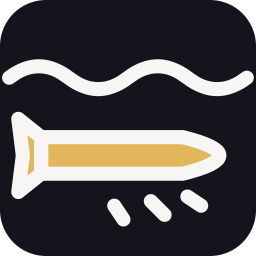

# الحزمة العسكرية — حزمة أسلحة عبودين (Military pack)

أسلحة البارجة من لعبة «حرب البارجة» (Table War)، عامة لأي لعبة طاولة عسكرية مصغّرة في Godot 4.6. ثمانية عشر سلاحًا بالرموز الدائمة `AB-W-023` … `AB-W-040` (الأحد عشر الأولى منذ v1.1، والسبعة الأخيرة منذ v1.2)، ولكل سلاح مثال حقيقي من نوعه كما تعرضه اللعبة. الأرقام كلها من `addons/aboden_blaster/military/military_catalog.gd` (هذه الصفحة مولّدة منه بـ `tools/gen_military_docs.gd`).

[← فهرس الأسلحة](CATALOG.md) · [الدليل](../README.md) · [السجل](CHANGELOG.md)

| | | | | | |
|---|---|---|---|---|---|
| [](weapons/AB-W-023_ballistic.md) | [](weapons/AB-W-024_cruise.md) | [](weapons/AB-W-025_artillery.md) | [](weapons/AB-W-026_mlrs.md) | [](weapons/AB-W-027_cluster.md) | [](weapons/AB-W-028_hypersonic.md) |
| `AB-W-023` صاروخ باليستي | `AB-W-024` صاروخ كروز | `AB-W-025` قذيفة مدفعية | `AB-W-026` راجمة صواريخ | `AB-W-027` صاروخ عنقودي | `AB-W-028` صاروخ فرط صوتي |
| [](weapons/AB-W-029_bunker.md) | [](weapons/AB-W-030_drone.md) | [](weapons/AB-W-031_antiship.md) | [](weapons/AB-W-032_jet.md) | [](weapons/AB-W-033_nuke.md) | [](weapons/AB-W-034_swarm.md) |
| `AB-W-029` خارق التحصينات | `AB-W-030` مسيّرة انتحارية | `AB-W-031` صاروخ مضاد للسفن | `AB-W-032` طائرة هجومية | `AB-W-033` قنبلة نووية | `AB-W-034` سرب مسيّرات |
| [](weapons/AB-W-035_aa.md) | [](weapons/AB-W-036_recon.md) | [](weapons/AB-W-037_atgm.md) | [](weapons/AB-W-038_glide.md) | [](weapons/AB-W-039_torpedo.md) | [](weapons/AB-W-040_heli.md) |
| `AB-W-035` صاروخ دفاع جوي | `AB-W-036` طائرة استطلاع مسيّرة | `AB-W-037` صاروخ مضاد للدروع | `AB-W-038` قنابل انزلاقية | `AB-W-039` طوربيد | `AB-W-040` مروحية هجومية |

## الجدول

الوحدات: «وحدة طاولة» (نموذج عرضه نحو وحدة واحدة، مقياس المشهد الأصلي 1:2000) والثواني. الجاذبية مصغّرة `G = 0.5` حتى تبدو الأقواس «كبيرة وثقيلة». نصف قطر الانفجار = `BLAST_R` (0.022) × `blast`.

| الرمز | الأيقونة | الاسم | مثال حقيقي | المعرّف | المسار | زمن الرحلة | الانفجار | الذخيرة | التبريد | إعادة التعبئة | المطلق | خاص | الفئة |
|---|---|---|---|---|---|---|---|---|---|---|---|---|---|
| [`AB-W-023`](weapons/AB-W-023_ballistic.md) |  | **صاروخ باليستي** (Ballistic missile) | Iskander | `ballistic` | قوس عالٍ | 2.6–3 ث | × 1.45 | 6 | 4 ث | 8 ث | خلايا الإطلاق العمودي | توهج إعادة الدخول | 2 متوسط (Medium) |
| [`AB-W-024`](weapons/AB-W-024_cruise.md) |  | **صاروخ كروز** (Cruise missile) | Tomahawk | `cruise` | مسار يتبع التضاريس | 1.5–3 ث، 0.42 و/ث | × 1 | 8 | 3 ث | 6 ث | قواذف الصناديق المائلة | — | 1 سهل (Easy) |
| [`AB-W-025`](weapons/AB-W-025_artillery.md) |  | **قذيفة مدفعية** (Artillery shell) | M777 | `artillery` | قوس منخفض سريع | 1.5–1.8 ث | × 0.6 | 30 | 0.8 ث | 2 ث | مدفع المقدمة | — | 0 أساسي (Starter) |
| [`AB-W-026`](weapons/AB-W-026_mlrs.md) |  | **راجمة صواريخ** (MLRS rocket salvo) | HIMARS | `mlrs` | قوس منخفض سريع | 1.4–1.7 ث | × 0.5 | 4 | 6 ث | 9 ث | حاضنة الراجمة | دفعة 8 صواريخ (كل 90 م.ث) ضمن 0.035 | 1 سهل (Easy) |
| [`AB-W-027`](weapons/AB-W-027_cluster.md) |  | **صاروخ عنقودي** (Cluster missile) | ATACMS | `cluster` | قوس عالٍ | 2.6–3 ث | × 0.45 | 3 | 7 ث | 12 ث | خلايا الإطلاق العمودي | 10 قنيبلات عند 62٪ من الرحلة ضمن 0.045 | 2 متوسط (Medium) |
| [`AB-W-028`](weapons/AB-W-028_hypersonic.md) |  | **صاروخ فرط صوتي** (Hypersonic glide missile) | Kinzhal | `hypersonic` | انزلاق فرط صوتي متمايل | 1.1–2.2 ث، 1.1 و/ث | × 1.75 | 3 | 8 ث | 14 ث | خلايا الإطلاق العمودي | توهج إعادة الدخول | 3 متقدم (Advanced) |
| [`AB-W-029`](weapons/AB-W-029_bunker.md) |  | **خارق التحصينات** (Bunker buster) | GBU-57 | `bunker` | طلعة ذهاب وعودة | 0.14 و/ث | × 1.15 | 2 | 2 ث | عند الهبوط | سطح الطيران | 1 قنبلة خارقة (`bunkerbomb`) ضمن 0 قبل الهدف بـ 0.035 ثم تعود وتهبط، حفرة أعمق × 2.2 | 3 متقدم (Advanced) |
| [`AB-W-030`](weapons/AB-W-030_drone.md) |  | **مسيّرة انتحارية** (Kamikaze drone) | Shahed-136 | `drone` | مسار يتبع التضاريس | 2.5–8 ث، 0.22 و/ث | × 0.7 | 10 | 2.5 ث | 5 ث | منحدر المسيّرات | — | 1 سهل (Easy) |
| [`AB-W-031`](weapons/AB-W-031_antiship.md) |  | **صاروخ مضاد للسفن** (Anti-ship missile) | Harpoon | `antiship` | مسار يتبع التضاريس | 1.2–3 ث، 0.5 و/ث | × 1.3 | 4 | 5 ث | 10 ث | قواذف الصناديق المائلة | — | 2 متوسط (Medium) |
| [`AB-W-032`](weapons/AB-W-032_jet.md) |  | **طائرة هجومية** (Strike jet) | F-15E | `jet` | طلعة ذهاب وعودة | 0.14 و/ث | × 0.8 | 2 | 2 ث | عند الهبوط | سطح الطيران | 4 قنابل (`jetbomb`) ضمن 0.012 قبل الهدف بـ 0.035 ثم تعود وتهبط | 3 متقدم (Advanced) |
| [`AB-W-033`](weapons/AB-W-033_nuke.md) |  | **قنبلة نووية** (Nuclear test) | B61 | `nuke` | قوس عالٍ | 3.4–3.8 ث | × 1 | 1 | 30 ث | 90 ث | فتحة الصومعة النووية | نصف قطر التدمير 0.16، موجة صدمة إلى × 2.6 في 3 ث، توهج إعادة الدخول | 4 نخبة (Elite) |
| [`AB-W-034`](weapons/AB-W-034_swarm.md) |  | **سرب مسيّرات** (Drone swarm) | Lancet | `swarm` | مسار يتبع التضاريس | 2–9 ث، 0.26 و/ث | × 0.35 | 3 | 6 ث | 12 ث | منحدر المسيّرات | دفعة 6 مسيّرات (كل 220 م.ث) ضمن 0.022 | 2 متوسط (Medium) |
| [`AB-W-035`](weapons/AB-W-035_aa.md) |  | **صاروخ دفاع جوي** (Anti-air missile) | Patriot | `aa` | ملاحقة هدف جوي | 0.55 و/ث | × 0.4 | 6 | 2 ث | 10 ث | خلايا الإطلاق العمودي | يلاحق هدفًا جويًا بسرعة 0.55 وينفجر على بعد 0.008 منه، يدمر نفسه بعد 6 ث | 2 متوسط (Medium) |
| [`AB-W-036`](weapons/AB-W-036_recon.md) |  | **طائرة استطلاع مسيّرة** (Reconnaissance drone) | ScanEagle | `recon` | طلعة ذهاب وعودة | 0.1 و/ث | × 0 | 1 | 2 ث | عند الهبوط | سطح الطيران | دورتان بنصف قطر 0.07 حول الهدف، تكشف ضمن 0.075، بلا انفجار، ثم تعود وتهبط | 1 سهل (Easy) |
| [`AB-W-037`](weapons/AB-W-037_atgm.md) |  | **صاروخ مضاد للدروع** (Anti-tank missile) | Javelin | `atgm` | قوس عالٍ | 1.3–1.6 ث | × 0.32 | 6 | 1.5 ث | 6 ث | قواذف الصناديق المائلة | يعطّل الدروع ضمن نصف قطر الانفجار × 2.6 | 1 سهل (Easy) |
| [`AB-W-038`](weapons/AB-W-038_glide.md) |  | **قنابل انزلاقية** (Glide bombs) | GBU-39 | `glide` | طلعة ذهاب وعودة | 0.15 و/ث | × 0.7 | 2 | 2 ث | عند الهبوط | سطح الطيران | 4 قنابل انزلاقية (`gbomb`) ضمن 0.014 قبل الهدف بـ 0.16 ثم تعود وتهبط | 2 متوسط (Medium) |
| [`AB-W-039`](weapons/AB-W-039_torpedo.md) |  | **طوربيد** (Torpedo) | Mk 48 | `torpedo` | تحت سطح الماء | 0.8–9 ث، 0.16 و/ث | × 1.35 | 4 | 4 ث | 10 ث | أنبوب الطوربيد | يجري تحت السطح بـ 1.6 مم ويتوقف عند الشاطئ | 2 متوسط (Medium) |
| [`AB-W-040`](weapons/AB-W-040_heli.md) |  | **مروحية هجومية** (Attack helicopter) | AH-64 Apache | `heli` | طلعة ذهاب وعودة | 0.09 و/ث | × 0.45 | 2 | 2 ث | عند الهبوط | سطح الطيران | 6 صواريخ (`hrocket`) ضمن 0.016 قبل الهدف بـ 0.07 ثم تعود وتهبط | 3 متقدم (Advanced) |

## الاستعمال

```gdscript
var ml := AbodenMilitaryLauncher.new()
world.add_child(ml)              # كل المواقع بإحداثيات ml المحلية (وحدات طاولة)
ml.setup(self)                   # المضيف: أي Node فيه ما يحتاجه من النداءات أدناه
var ship := AbodenMilitaryShip.new()   # اختياري: سفينة الإطلاق
ml.add_child(ship)
ml.ship = ship
ml.impacted.connect(_on_impact) # الضرر على عالمك أنت: حفرة، مبانٍ، نقاط
ml.aim(target)                   # نقاط المسار وحلقة الهدف
ml.fire(target, "cruise")        # false إن كان في تبريد أو بلا ذخيرة
```

`step(dt)` يجري تلقائيًا في `_physics_process` (`auto_step`)، أو أوقفه ونادِه بنفسك (للحركة البطيئة `slow_motion` و`slow_factor`، وللقطات والاختبارات).

### واجهة المضيف (كلها اختيارية)

| النداء | ما يعيده | الافتراضي |
|---|---|---|
| `military_surface(x, z) -> float` | ارتفاع ما تصطدم به القذيفة (أرض أو سطح ماء)، و`-INF` حيث لا شيء | `0.0` (أرض مستوية) |
| `military_ceiling(x, z) -> float` | أعلى ما يصل إليه صاروخ أو دخان هناك (قبة زجاجية، سقف كهف). الأقواس تنخفض تحته والطائرات تطير تحته والدخان ينتشر تحته | سماء مفتوحة |
| `military_water_depth(x, z) -> float` | عمق الماء فوق الأرض هناك (أكثر من 1.5 مم: رذاذ ماء بلا انفجار) | `0.0` (يابسة) |
| `military_launch_point(id) -> Vector3` | من أين يخرج السلاح | قاذفه على `ship`، وإلا `origin` |
| `military_roof(x, z) -> float` | أعلى المباني القائمة هناك، و`-INF` حيث لا مبنى. الكروز والمسيّرات والمضاد للسفن والفرط صوتي تصعد فوقها في الوقت المناسب كما تصعد فوق التلال (v1.2) | بلا مبانٍ |
| `military_air_target(from, aim) -> Variant` | ما يلاحقه صاروخ الدفاع الجوي حين يُطلق نحو `aim`: عقدة `Node3D` يتبعها (تضيع إن حُذفت أو أُخفيت أو خرجت من الشجرة)، أو نقطة `Vector3`، أو `null` (لا شيء في الجو: لا يُطلق ولا تنقص ذخيرته) (v1.2) | النقطة `aim` نفسها: يطير إليها وينفجر في الجو هناك |
| `military_hit(point, info)` | انفجرت قذيفة (مثل الإشارة `impacted`) | — |
| `military_scan(point, radius)` | طائرة الاستطلاع تنظر إلى الأسفل من `point` (موضعها في الجو) ضمن `radius` أفقيًا، كل 0.1 ث وهي تدور؛ المضيف يقرر ما تراه ويعلّمه (مثل `recon_scan`) (v1.2) | — |
| `military_shock(point, r_from, r_to, k)` | تقدّمت جبهة موجة الصدمة النووية من `r_from` إلى `r_to` (`k` من 0 إلى 1 من مسيرها): المضيف يسقط ما في تلك الحلقة (مثل `shock_wave`) (v1.2) | — |
| `military_sfx(name, k, pos)` | صوت: `launch` و`boom` و`thump` | مشغّل الحزمة المدمج |

### الإشارات

- `launched(id, from, to, sub)`: خرجت قذيفة (`sub` صحيح لما يتبع الأولى في الدفعة والقنيبلات وحمولة الطائرات).
- `impacted(point, info)`: `info` = `{id, kind, blast_r, crater_r, crater_d, ejecta, nuke_r?, wave_r?, armor_r?, target?}` و`kind` واحد من `land` / `water` / `shallow` / `nuke` / `air`. `armor_r` للأسلحة المضادة للدروع (المضاد للدروع وصواريخ المروحية): كل مدرّعة ضمنه تتعطل. `air` انفجار صاروخ الدفاع الجوي على هدفه في الجو، و`target` ما أصابه.
- `sortie_landed(id)`: عادت طائرة (الهجومية، حاملة الخارق، حاملة القنابل الانزلاقية، المروحية، الاستطلاع) وهبطت (تعود ذخيرتها).
- `sortie_lost(id)`: أُسقطت طائرة (`shoot_down`): لا تعود، وتصل بديلة بعد `LOST_RELOAD` (25 ث).
- `shot_down(id, point, by_host)`: دُمّرت قذيفة في الجو؛ `by_host` صحيح إن أسقطها المضيف، وخطأ إن فقد صاروخ الدفاع الجوي هدفه فدمّر نفسه.
- `recon_scan(point, radius)`: طائرة الاستطلاع تنظر (مثل `military_scan`).
- `shock_wave(point, r_from, r_to, k)`: جبهة موجة الصدمة النووية (مثل `military_shock`).

### دفاع العدو الجوي (عند المضيف)

`air_shots()` يعيد كل ما في الجو الآن `[{serial, id, position, velocity, sub, aircraft, intercept}]` (`intercept` احتمال الاشتباك في اللعبة، تلميح من الكتالوج)، و`shoot_down(serial)` يدمّر واحدة منها في الجو (انفجار جوي بلا ارتطام). منصات صواريخ أرض-جو أو مدفع قريب في لعبتك تقرأ هذه القائمة وتقرر بنفسها. الطوربيد لا يظهر فيها.

`fire_at_air(target, "aa")` يطلق صاروخ الدفاع الجوي على عقدة أو نقطة مباشرة.

### الذخيرة

`ammo(id)` و`cooldown_left(id)` و`can_fire(id)` و`refill()`. لكل سلاح `ammo` طلقات و`cooldown` بين طلقتين، وتعود طلقة كل `reload` ثانية؛ كل طائرة تعود ذخيرتها حين تهبط (والمُسقطة بعد 25 ث). `unlimited = true` يتجاهل الذخيرة والتبريد.

### ما يبقى عند المضيف

مثل v1.1: الحفر وتكسّر المباني والحطام والسكان خاصة بعالمك عبر `impacted`. ومنذ v1.2: ما تكشفه طائرة الاستطلاع (اللعبة ترسم معيّنًا كهرمانيًا فوق كل موقع وسفينة ووحدة معادية تراها، 60 ث)، اعتراض العدو لقذائفك (`air_shots` و`shoot_down`)، الطائرات المعادية التي يلاحقها صاروخ الدفاع الجوي (`military_air_target`)، تعطيل المدرعات (`armor_r`)، السفن التي يصيبها الطوربيد (`kind` = `water` عند الهدف)، المباني التي تتجاوزها الصواريخ المنخفضة (`military_roof`)، وما تُسقطه موجة الصدمة النووية والحرائق في الأنقاض (`shock_wave`، و`fx.fire_at(p)` لإشعالها).

### الملفات

```
addons/aboden_blaster/military/
├── military_catalog.gd     AbodenMilitaryCatalog: الأسماء والرموز والأرقام (المصدر الوحيد)
├── military_flight.gd      AbodenMilitaryFlight: المسارات (باليستي، كروز يتبع التضاريس والمباني، طلعة جوية ودوران الاستطلاع، انزلاق فرط صوتي، قنبلة انزلاقية، طوربيد)
├── military_launcher.gd    AbodenMilitaryLauncher: الإطلاق والطيران والارتطام والذخيرة، الدفاع الجوي، موجة الصدمة
├── military_fx.gd          AbodenMilitaryFx: الدخان والنار والرذاذ والفطر النووي المتتابع والانفجار الجوي والحرائق (3 دفعات رسم)
├── military_looks.gd       AbodenMilitaryLooks: مجسمات القذائف والسفينة (بالكود)
├── military_ship.gd        AbodenMilitaryShip: سفينة الإطلاق
├── military_mesh.gd        AbodenMilitaryMesh: باني المجسمات
├── puff*.gdshader(inc)     ظلال الدخان والنار
├── icons/<id>.svg|png      الأيقونات (SVG المصدر، PNG 256 بكسل)
└── tools_bake_icons.gd     خبز الأيقونات من SVG
```

الاختبارات: `godot --headless --path . -s res://tests/run_military_tests.gd`.

العرض: `demo/military_demo.tscn` (طاولة صغيرة بقارب هدف في البحر وطائرة هدف تدور فوقها؛ 1..9 و0 و- و= ثم Q W E R T Y للأسلحة الثمانية عشر، Tab للتالي، S للحركة البطيئة). اللقطات: `-- --all=res://docs/shots` (بعرض رسومي، مثلًا `xvfb-run godot --rendering-driver opengl3`).
