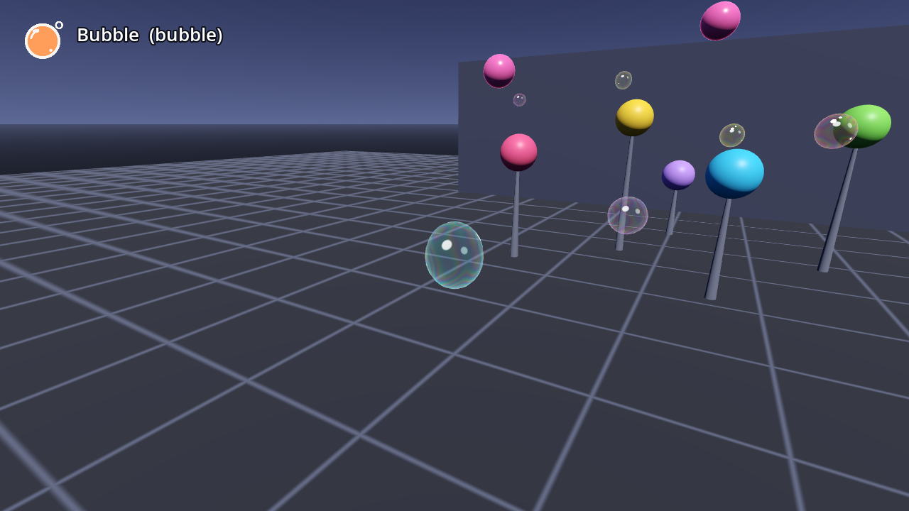

# AB-W-003 — فقاعة (Bubble)

[← فهرس الأسلحة](../CATALOG.md)

| | |
|---|---|
|  |  |

| الحقل | القيمة |
|---|---|
| الرمز (code) | `AB-W-003` |
| الحزمة (pack) | مرحة (playful) |
| المعرّف (id) | `bubble` |
| الاسم | فقاعة (Bubble) |
| الوصف | فقاعات صابون ملونة تتمايل ببطء — *Slow, wobbling rainbow soap bubbles* |
| العائلة (category) | قذيفة مباشرة (direct) |
| طريقة الإيصال (delivery) | قذيفة (projectile) |
| المسار (trajectory) | طافٍ (floating) |
| نموذج الإصابة (hit) | هدف واحد (single) |
| الدور (role) | هجوم (attack) |
| الفئة/الندرة (tier) | 0 أساسي (Starter) |
| شرط الفتح الأصلي (origin unlock) | مفتوح من البداية (أساسي) |
| الأيقونة | `addons/aboden_blaster/icons/bubble.png` (`bubble`) |
| الحالة (status) | مستقر (stable) |
| الإصدار (version) | v1.0 |

## السلوك

فقاعات صابون بطيئة (4.2 م/ث) بجاذبية سالبة صغيرة (‎−0.06 g) فتصعد قليلًا، وتتمايل جانبيًا (تسارع جيبي 0.25 م/ث²). نصف قطرها كبير (0.06 م) فتصيب بسهولة. تتوقف عند أول هدف أو جسم، وإن انتهى عمرها (3.6 ث) دون أن تصيب تفرقع بصوت `start_pop`.

**مشترك بين كل الأسلحة:** تُطلق بـ `fire(hand, origin, dir)` أو `fire_at(origin, target_point, hand)` (يصوّب الاتجاه نحو النقطة)؛ الفوهة 0.08 م أمام نقطة الإطلاق؛ لكل يد مؤقّت `cool` خاص بها؛ الطلقة الثلاثية (`shot_fan()` = 3) تدوّر الاتجاه ±0.11 راديان (`FAN_STEP`) حول المحور العمودي؛ كل الأطوال × `blaster_scale()`.

## المعاملات (`AbodenShotCatalog.SHOT_STYLE["bubble"]`)

| المعامل | القيمة | المعنى | الوحدة |
|---|---|---|---|
| `speed` | 4.2 | السرعة الابتدائية | م/ث |
| `grav` | -0.06 | الجاذبية (مضاعف g = 9.8 م/ث²؛ السالب يطفو) | × g |
| `life` | 3.6 | العمر الأقصى | ث |
| `r` | 0.06 | نصف قطر الإصابة | م |
| `cool` | 0.16 | أقل فاصل بين طلقتين لليد نفسها (معدل الإطلاق عند الضغط المستمر) | ث |
| `sk` | 0.18 | قيمة k لصوت الإطلاق (الشدة/الطبقة) | — |

## المظهر

- **المجسم:** كرة فقاعة (`BUBBLE_SHADER`: غشاء متلوّن يدور، نقاط بيضاء، حافة لامعة، شفافية) يرسمها `shot_crowd`. اللون من `BUBBLE_TINTS` يمتزج 60% مع لون غشاء يتغير مع الزمن، وتتمطّط (±12%).
- **لا وميض فوهة** واهتزاز اليد خفيف (0.12).
- **الإصابة:** `impact()`.

## الأصوات

- whoosh — اندفاع (k = الشدة: 0.2…1.0) ← **صوت الإطلاق**
- start_pop — فرقعة
- thump — ارتطام بجسم صلب لا يُحتسب (k 0.25)

## ملاحظات الضبط

`grav` السالب هو ما يجعلها تطفو؛ اجعله 0 لتطير مستقيمة. التمايل ثابت في `_move` (0.25 × k).

## الاختبارات (`tests/run_tests.gd`)

- shots: every style fires with its sound
- shots: every style pops a soft target
- shots: every style hits a stage target

## سجل التغييرات

| الإصدار | التاريخ | التغيير |
|---|---|---|
| v1.0 | 2026-10-17 | الإصدار الأول (الأرقام والسلوك مطابقة للأصل؛ انظر CHANGELOG). |
