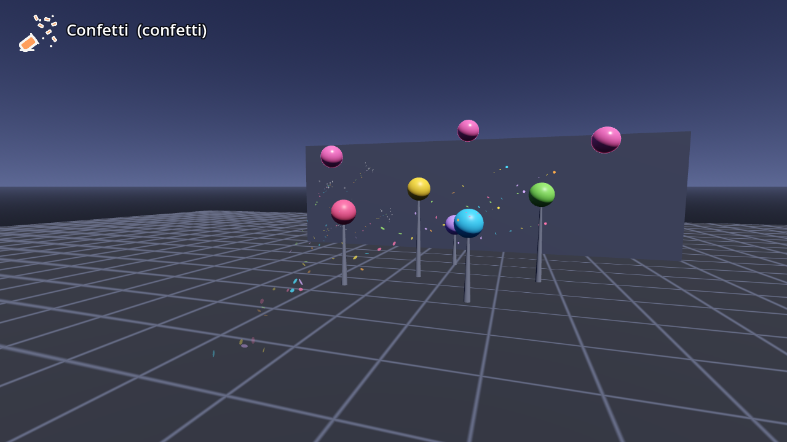

# AB-W-005 — قصاصات (Confetti)

[← فهرس الأسلحة](../CATALOG.md)

| | |
|---|---|
|  |  |

| الحقل | القيمة |
|---|---|
| الرمز (code) | `AB-W-005` |
| الحزمة (pack) | مرحة (playful) |
| المعرّف (id) | `confetti` |
| الاسم | قصاصات (Confetti) |
| الوصف | مدفع قصاصات: خمس كرات في مخروط — *Confetti cannon: five pellets in a cone* |
| العائلة (category) | رشّ/متعدد (spray)، باليستية (ballistic) |
| طريقة الإيصال (delivery) | قذيفة (projectile) |
| المسار (trajectory) | قوسي (ballistic) |
| نموذج الإصابة (hit) | هدف واحد (single) |
| الدور (role) | هجوم (attack) |
| الفئة/الندرة (tier) | 1 سهل (Easy) |
| شرط الفتح الأصلي (origin unlock) | `hoop3` — ٣ سلات متتابعة (3 hoops in a row)، الهدف 3 |
| الأيقونة | `addons/aboden_blaster/icons/confetti.png` (`confetti`) |
| الحالة (status) | مستقر (stable) |
| الإصدار (version) | v1.0 |

## السلوك

مدفع قصاصات: خمس كرات في الطلقة الواحدة — واحدة في المنتصف وأربع في حلقة حولها على زاوية 0.12 راديان × (0.65–1.0) بدوران عشوائي. كل كرة قذيفة باليستية مستقلة (0.45 g) تصيب هدفًا واحدًا وتتوقف. مع الطلقة الثلاثية (fan) يصبح 15 كرة.

**مشترك بين كل الأسلحة:** تُطلق بـ `fire(hand, origin, dir)` أو `fire_at(origin, target_point, hand)` (يصوّب الاتجاه نحو النقطة)؛ الفوهة 0.08 م أمام نقطة الإطلاق؛ لكل يد مؤقّت `cool` خاص بها؛ الطلقة الثلاثية (`shot_fan()` = 3) تدوّر الاتجاه ±0.11 راديان (`FAN_STEP`) حول المحور العمودي؛ كل الأطوال × `blaster_scale()`.

## المعاملات (`AbodenShotCatalog.SHOT_STYLE["confetti"]`)

| المعامل | القيمة | المعنى | الوحدة |
|---|---|---|---|
| `speed` | 24.0 | السرعة الابتدائية | م/ث |
| `grav` | 0.45 | الجاذبية (مضاعف g = 9.8 م/ث²؛ السالب يطفو) | × g |
| `life` | 0.9 | العمر الأقصى | ث |
| `r` | 0.018 | نصف قطر الإصابة | م |
| `cool` | 0.3 | أقل فاصل بين طلقتين لليد نفسها (معدل الإطلاق عند الضغط المستمر) | ث |
| `pellets` | 5 | عدد الأجسام في الطلقة (كرات، قطرات، قنابل صغيرة) | عدد |
| `cone` | 0.12 | نصف زاوية المخروط | راديان |
| `sk` | 0.5 | قيمة k لصوت الإطلاق (الشدة/الطبقة) | — |

## المظهر

- **المجسم:** كرات ملوّنة صغيرة (0.018 م) من `CONFETTI_COLS` تُرسم مع الشرر (MultiMesh واحد).
- **الأثر:** قصاصات مسطّحة تدور (flake: 0.01×0.0018×0.007 م تقريبًا) تتهادى نازلة ببطء (جاذبية 0.25 ومقاومة هواء 0.25^dt)، بنسبة 70% في كل إطار.
- **وميض الفوهة:** ‎#fff2c2.

## الأصوات

- swish — صفير (3 نسخ) ← **صوت الإطلاق**
- start_pop — فرقعة
- thump — ارتطام بجسم صلب لا يُحتسب (k 0.25)

## ملاحظات الضبط

`pellets` و`cone` يحددان الانتشار. الكرة الأولى دائمًا في المنتصف.

## الاختبارات (`tests/run_tests.gd`)

- confetti: five pellets fan out in a cone
- confetti: with confetti trails
- shots: every style hits a stage target

## سجل التغييرات

| الإصدار | التاريخ | التغيير |
|---|---|---|
| v1.0 | 2026-10-17 | الإصدار الأول (الأرقام والسلوك مطابقة للأصل؛ انظر CHANGELOG). |
