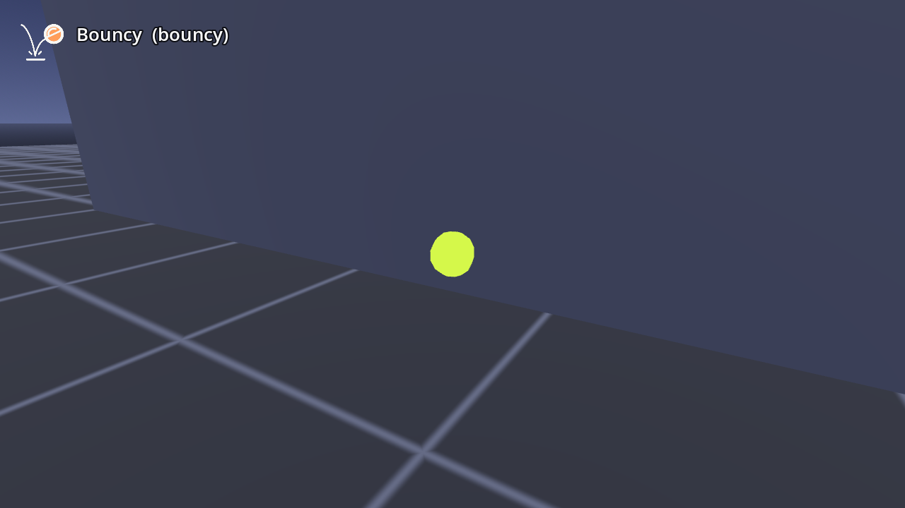

# AB-W-006 — نطّاطة (Bouncy)

[← فهرس الأسلحة](../CATALOG.md)

| | |
|---|---|
|  |  |

| الحقل | القيمة |
|---|---|
| الرمز (code) | `AB-W-006` |
| الحزمة (pack) | مرحة (playful) |
| المعرّف (id) | `bouncy` |
| الاسم | نطّاطة (Bouncy) |
| الوصف | كرة مطاطية تنطّ بالمكان عشر ثوانٍ — *A rubber ball that bounces about for ten seconds* |
| العائلة (category) | ارتداد/نطّ (bouncing)، باليستية (ballistic) |
| طريقة الإيصال (delivery) | قذيفة (projectile) |
| المسار (trajectory) | قوسي (ballistic) |
| نموذج الإصابة (hit) | ارتداد (bounce) |
| الدور (role) | هجوم (attack) |
| الفئة/الندرة (tier) | 1 سهل (Easy) |
| شرط الفتح الأصلي (origin unlock) | `firework10` — فجّر ١٠ أهداف بالألعاب النارية (Blast 10 targets with fireworks)، الهدف 10 |
| الأيقونة | `addons/aboden_blaster/icons/bouncy.png` (`bouncy`) |
| الحالة (status) | مستقر (stable) |
| الإصدار (version) | v1.0 |

## السلوك

كرة مطاطية تنطّ في المكان طوال عمرها (10 ث): كل ارتطام بالأرض يعيدها بقفزة لا تقل عن `BOUNCY_HOP` = 3.2 م/ث (أو 0.8 من سرعة سقوطها)، ولا تقل سرعتها الأفقية عن `BOUNCY_ROLL` = 1.6 م/ث. تفرقع الأهداف الناعمة وتكمل (السرعة × 0.85)، وترتد عن أهداف المسرح والأجسام (معامل 1.8 على المركبة العمودية) وعن جدران المضيف (السرعة × 1.25). حدّ الإصابات والارتدادات مليار (بلا حد عمليًا). يبقى منها في الهواء `BOUNCY_MAX` = 20 كحد أقصى: الجديدة تحل محل الأقدم (بفرقعة صغيرة). عندما يقول المضيف `blaster_roam() == true` (لا جدران حولك) ترجع الكرة نحوك إذا ابتعدت أكثر من `BOUNCY_ROAM` = 6 م.

**مشترك بين كل الأسلحة:** تُطلق بـ `fire(hand, origin, dir)` أو `fire_at(origin, target_point, hand)` (يصوّب الاتجاه نحو النقطة)؛ الفوهة 0.08 م أمام نقطة الإطلاق؛ لكل يد مؤقّت `cool` خاص بها؛ الطلقة الثلاثية (`shot_fan()` = 3) تدوّر الاتجاه ±0.11 راديان (`FAN_STEP`) حول المحور العمودي؛ كل الأطوال × `blaster_scale()`.

## المعاملات (`AbodenShotCatalog.SHOT_STYLE["bouncy"]`)

| المعامل | القيمة | المعنى | الوحدة |
|---|---|---|---|
| `speed` | 15.0 | السرعة الابتدائية | م/ث |
| `grav` | 1.0 | الجاذبية (مضاعف g = 9.8 م/ث²؛ السالب يطفو) | × g |
| `life` | 10.0 | العمر الأقصى | ث |
| `r` | 0.03 | نصف قطر الإصابة | م |
| `cool` | 0.22 | أقل فاصل بين طلقتين لليد نفسها (معدل الإطلاق عند الضغط المستمر) | ث |
| `bounces` | 1000000000 | أقصى عدد ارتدادات (1000000000 = بلا حد) | عدد |
| `pops` | 1000000000 | أقصى عدد إصابات قبل أن تتوقف (1000000000 = بلا حد) | عدد |
| `sk` | 1.35 | قيمة k لصوت الإطلاق (الشدة/الطبقة) | — |
| `BOUNCY_MAX` | 20 | أقصى عدد كرات في الجو | عدد |
| `BOUNCY_HOP` | 3.2 | أقل سرعة قفزة بعد ارتطام الأرض | م/ث |
| `BOUNCY_ROLL` | 1.6 | أقل سرعة أفقية | م/ث |
| `BOUNCY_ROAM` | 6.0 | مسافة العودة نحو اللاعب (مع blaster_roam) | م |

## المظهر

- **المجسم:** كرة 0.03 م بلون من `BOUNCY_COLS` تُرسم مع الشرر.
- **بلا أثر ذيل.** وميض الفوهة ‎#ffe9b0.
- **الصوت:** `squeak` عالي الطبقة (1.35) عند الإطلاق، و`bricks_tink` بحسب قوة كل ارتطام.

## الأصوات

- squeak — صرير مطاطي (k = الطبقة: 0.7…1.35) ← **صوت الإطلاق**
- bricks_tink — رنّة (k = الشدة 0…1)

## ملاحظات الضبط

`life` = 10 ث، والحد 20 كرة لحماية معدل الإطارات في النظارة. الإصابات المتعددة لكرة واحدة تُبلَّغ كـ `bouncy3` (أفضل قيمة).

## الاختبارات (`tests/run_tests.gd`)

- bouncy: bounces off the floor and carries on
- bouncy: pops on through more than one
- bouncy: the hits of one ball are reported for bouncy3
- bouncy: still bouncing about after 6 s
- bouncy: gone after its ten seconds
- bouncy: at most 20 at once, the oldest makes way
- walls: a bouncy ball bounces back off it

## سجل التغييرات

| الإصدار | التاريخ | التغيير |
|---|---|---|
| v1.0 | 2026-10-17 | الإصدار الأول (الأرقام والسلوك مطابقة للأصل؛ انظر CHANGELOG). |
