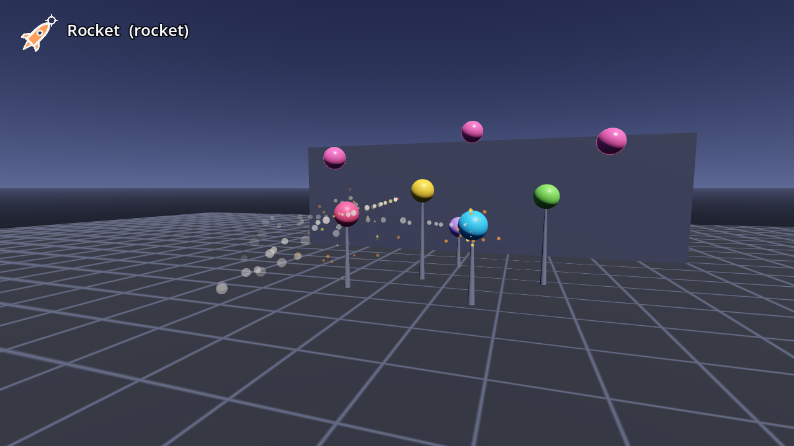

# AB-W-010 — صاروخ (Rocket)

[← فهرس الأسلحة](../CATALOG.md)

| | |
|---|---|
|  |  |

| الحقل | القيمة |
|---|---|
| الرمز (code) | `AB-W-010` |
| الحزمة (pack) | مرحة (playful) |
| المعرّف (id) | `rocket` |
| الاسم | صاروخ (Rocket) |
| الوصف | صاروخ موجّه، كل صاروخ يلاحق هدفه — *Homing rockets, each after its own target* |
| العائلة (category) | موجّهة (homing)، منطقة تأثير/انفجار (area) |
| طريقة الإيصال (delivery) | قذيفة (projectile) |
| المسار (trajectory) | موجّه (homing) |
| نموذج الإصابة (hit) | انفجار/رذاذ (splash) |
| الدور (role) | هجوم (attack) |
| الفئة/الندرة (tier) | 3 متقدم (Advanced) |
| شرط الفتح الأصلي (origin unlock) | `boomerang3` — بوميرانغ يصيب ويرجع ليدك ٣ مرات (Catch 3 boomerangs that hit something)، الهدف 3 |
| الأيقونة | `addons/aboden_blaster/icons/rocket.png` (`rocket`) |
| الحالة (status) | مستقر (stable) |
| الإصدار (version) | v1.0 |

## السلوك

صاروخ موجّه: يبدأ بطيئًا (15% من السرعة) ويتسارع حتى السرعة الكاملة خلال 0.5 ث. كل 0.1 ث (إلى أن يجد هدفًا) يبحث عن أقرب هدف أمامه (ضمن 16 م، وبزاوية لا تتجاوز ≈ 72°) بدرجة `d × (1.6 − facing)`، ويتجنب الأهداف التي يلاحقها صاروخ آخر في الجو ما دام هناك غيرها — فصاروخان متتاليان أو ثلاثة صواريخ الطلقة الثلاثية تتوزع على أهداف مختلفة. بعد 0.1 ث يلتف نحو هدفه بسرعة 6 راديان/ث. ينفجر بجوار هدفه (R + 0.8 × نصف قطر الهدف)، أو عند أي ارتطام، أو بعد 2.6 ث، فيفرقع كل ما في 0.75 م.

**مشترك بين كل الأسلحة:** تُطلق بـ `fire(hand, origin, dir)` أو `fire_at(origin, target_point, hand)` (يصوّب الاتجاه نحو النقطة)؛ الفوهة 0.08 م أمام نقطة الإطلاق؛ لكل يد مؤقّت `cool` خاص بها؛ الطلقة الثلاثية (`shot_fan()` = 3) تدوّر الاتجاه ±0.11 راديان (`FAN_STEP`) حول المحور العمودي؛ كل الأطوال × `blaster_scale()`.

## المعاملات (`AbodenShotCatalog.SHOT_STYLE["rocket"]`)

| المعامل | القيمة | المعنى | الوحدة |
|---|---|---|---|
| `speed` | 20.0 | السرعة الابتدائية | م/ث |
| `grav` | 0.0 | الجاذبية (مضاعف g = 9.8 م/ث²؛ السالب يطفو) | × g |
| `life` | 2.6 | العمر الأقصى | ث |
| `r` | 0.03 | نصف قطر الإصابة | م |
| `cool` | 0.6 | أقل فاصل بين طلقتين لليد نفسها (معدل الإطلاق عند الضغط المستمر) | ث |
| `burst` | 0.75 | نصف قطر الانفجار (يفرقع ما حوله) | م |
| `turn` | 6.0 | سرعة الالتفاف نحو الهدف | راديان/ث |
| `seek` | 16.0 | مدى البحث عن هدف | م |
| `sk` | 1.0 | قيمة k لصوت الإطلاق (الشدة/الطبقة) | — |

## المظهر

- **المجسم:** جسم أحمر أسطواني (‎#e8473c، 0.11 م)، رأس كريمي مخروطي (‎#f4efe6)، ثلاث زعانف زرقاء (‎#3a6fd8)، ولهب يرتعش (‎#ffcf6a إضافي)؛ يتجه مع سرعته.
- **الأثر:** لهب خلفه وكل إطار تقريبًا دخان رمادي ‎#bdb8b0 يتصاعد.
- **الانفجار (`explosion`):** وميض 0.09 م، 26 شرارة نار (‎#ff7a2e / ‎#ffd34d)، 10 كرات دخان ‎#8a8580. وميض الفوهة ‎#ffb347.

## الأصوات

- whoosh — اندفاع (k = الشدة: 0.2…1.0) ← **صوت الإطلاق**
- boom — انفجار (3 نسخ)

## ملاحظات الضبط

`turn` يحدد حدة الالتفاف (الأكبر = أدق)، و`seek` مدى البحث، و`burst` قوة الانفجار. الأهداف هي الأهداف الناعمة للمضيف وأهداف المسرح المخفية معًا.

## الاختبارات (`tests/run_tests.gd`)

- rocket: starts slow
- rocket: homes in on a target off to the side
- rocket: explodes with a radius
- rocket: what its blast hits is credited
- rocket: two in the air pick different targets
- rocket: the triple shot's three rockets go for three targets

## سجل التغييرات

| الإصدار | التاريخ | التغيير |
|---|---|---|
| v1.0 | 2026-10-17 | الإصدار الأول (الأرقام والسلوك مطابقة للأصل؛ انظر CHANGELOG). |
