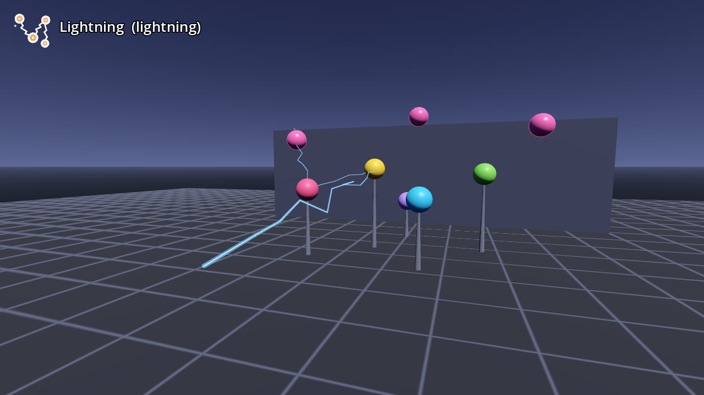

# AB-W-011 — صاعقة (Lightning)

[← فهرس الأسلحة](../CATALOG.md)

| | |
|---|---|
|  |  |

| الحقل | القيمة |
|---|---|
| الرمز (code) | `AB-W-011` |
| الحزمة (pack) | مرحة (playful) |
| المعرّف (id) | `lightning` |
| الاسم | صاعقة (Lightning) |
| الوصف | صاعقة تقفز بين ٤ أهداف — *Lightning that chains through 4 targets* |
| العائلة (category) | فورية/شعاع (instant) |
| طريقة الإيصال (delivery) | شعاع فوري (hitscan) |
| المسار (trajectory) | موجّه (homing) |
| نموذج الإصابة (hit) | تسلسل (chain) |
| الدور (role) | هجوم (attack) |
| الفئة/الندرة (tier) | 4 نخبة (Elite) |
| شرط الفتح الأصلي (origin unlock) | `rocket20` — اصب ٢٠ هدف بالصواريخ (Hit 20 targets with rockets)، الهدف 20 |
| الأيقونة | `addons/aboden_blaster/icons/lightning.png` (`lightning`) |
| الحالة (status) | مستقر (stable) |
| الإصدار (version) | v1.0 |

## السلوك

صاعقة فورية: تختار أول هدف داخل مخروط 0.32 راديان حول اتجاه التصويب وضمن 22 م (الأقرب إلى خط التصويب أولًا: `زاوية × 4 + بعد / مدى`)، ثم تقفز إلى أقرب هدف لم تُصبه ضمن 3 م من الهدف الأخير، حتى 4 أهداف. إن لم تجد هدفًا: فرقعة مستقيمة حتى نصف المدى تصيب أول جسم في المسرح. يُبلَّغ عدد الأهداف في السلسلة كـ `chain4` (أفضل قيمة).

**مشترك بين كل الأسلحة:** تُطلق بـ `fire(hand, origin, dir)` أو `fire_at(origin, target_point, hand)` (يصوّب الاتجاه نحو النقطة)؛ الفوهة 0.08 م أمام نقطة الإطلاق؛ لكل يد مؤقّت `cool` خاص بها؛ الطلقة الثلاثية (`shot_fan()` = 3) تدوّر الاتجاه ±0.11 راديان (`FAN_STEP`) حول المحور العمودي؛ كل الأطوال × `blaster_scale()`.

## المعاملات (`AbodenShotCatalog.SHOT_STYLE["lightning"]`)

| المعامل | القيمة | المعنى | الوحدة |
|---|---|---|---|
| `speed` | 0.0 | السرعة الابتدائية | م/ث |
| `grav` | 0.0 | الجاذبية (مضاعف g = 9.8 م/ث²؛ السالب يطفو) | × g |
| `life` | 0.32 | العمر الأقصى | ث |
| `r` | 0.02 | نصف قطر الإصابة | م |
| `cool` | 0.45 | أقل فاصل بين طلقتين لليد نفسها (معدل الإطلاق عند الضغط المستمر) | ث |
| `range` | 22.0 | المدى | م |
| `chain` | 4 | أقصى عدد أهداف في السلسلة | عدد |
| `hop` | 3.0 | أبعد قفزة بين هدفين | م |
| `cone` | 0.32 | نصف زاوية المخروط | راديان |
| `sk` | 1.0 | قيمة k لصوت الإطلاق (الشدة/الطبقة) | — |

## المظهر

- **الأقواس:** خطوط متعرّجة زرقاء ‎#5aa8ff (عرض 0.016 م، تعرّج 0.12) بنواة فاتحة، تتغيّر تعرّجاتها 30 مرة في الثانية وتخبو خلال 0.32 ث.
- **عند كل هدف:** وميض ‎#e8f4ff 0.04 م، و`bricks_tink` لكل قفزة بعد الأولى.
- **وميض الفوهة:** ‎#cfe8ff.

## الأصوات

- cans_clang — قرقعة صاعقة (k 1.0، 3 نسخ) ← **صوت الإطلاق**
- bricks_tink — رنّة (k = الشدة 0…1)

## ملاحظات الضبط

`chain` عدد الأهداف، و`hop` أبعد قفزة، و`cone` سماحية التصويب.

## الاختبارات (`tests/run_tests.gd`)

- lightning: chains through four targets, one hop at a time
- lightning: a chain of four is reported for chain4
- lightning: along jagged arcs
- lightning: from a stage target on to a soft one

## سجل التغييرات

| الإصدار | التاريخ | التغيير |
|---|---|---|
| v1.0 | 2026-10-17 | الإصدار الأول (الأرقام والسلوك مطابقة للأصل؛ انظر CHANGELOG). |
