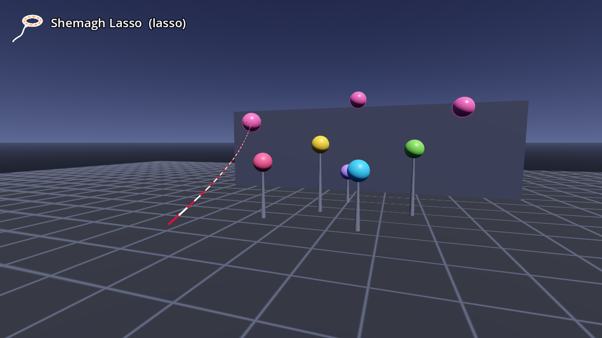

# AB-W-018 — حبل الشماغ (Shemagh Lasso)

[← فهرس الأسلحة](../CATALOG.md)

| | |
|---|---|
|  |  |

| الحقل | القيمة |
|---|---|
| الرمز (code) | `AB-W-018` |
| الحزمة (pack) | مرحة (playful) |
| المعرّف (id) | `lasso` |
| الاسم | حبل الشماغ (Shemagh Lasso) |
| الوصف | حبل بنقشة الشماغ يلتقط الهدف ويسحبه نحوك — *A shemagh-patterned rope that catches a target and pulls it to you* |
| العائلة (category) | باليستية (ballistic)، مرتدّة/عائدة (returning) |
| طريقة الإيصال (delivery) | قذيفة (projectile) |
| المسار (trajectory) | قوسي (ballistic) |
| نموذج الإصابة (hit) | هدف واحد (single) |
| الدور (role) | إسناد (support) |
| الفئة/الندرة (tier) | 2 متوسط (Medium) |
| شرط الفتح الأصلي (origin unlock) | لا شرط (سلاح جديد في v1.2، لم يكن في اللعبة الأصلية) |
| الأيقونة | `addons/aboden_blaster/icons/lasso.png` (`lasso`) |
| الحالة (status) | مستقر (stable) |
| الإصدار (version) | v1.2 |

## السلوك

حبل بنقشة الشماغ يُرمى بقوس (11 م/ث، 0.5 g). إن بلغت حلقته هدفًا ناعمًا وللمضيف **`blaster_pull(target, to, strength)`**: تلتقطه (صوت `snap`، بلا فرقعة، ويُبث `shot_hit`)، وتبقى عليه وتسحبه نحو اليد بـ 3 م/ث (`tug`) مدة 1.2 ث (`drag`) أو حتى يصل 0.35 م من اليد أو يختفي، ثم تفلته وتُلفّ عائدة. بلا `blaster_pull` الالتقاط إصابة عادية (`blaster_hit`، فرقعة) ثم يعود الحبل. هدف المسرح يأخذ الإصابة عبر `shoot()` ويعود الحبل. إن لم يلتقط شيئًا خلال 0.9 ث (`life`)، أو ارتطم بجسم أو جدار أو الأرض، يعود إلى اليد (`blaster_hand` أو مكان الإطلاق) بسرعة 15.4 م/ث ولا يصيب شيئًا في العودة.

**مشترك بين كل الأسلحة:** تُطلق بـ `fire(hand, origin, dir)` أو `fire_at(origin, target_point, hand)` (يصوّب الاتجاه نحو النقطة)؛ الفوهة 0.08 م أمام نقطة الإطلاق؛ لكل يد مؤقّت `cool` خاص بها؛ الطلقة الثلاثية (`shot_fan()` = 3) تدوّر الاتجاه ±0.11 راديان (`FAN_STEP`) حول المحور العمودي؛ كل الأطوال × `blaster_scale()`.

## المعاملات (`AbodenShotCatalog.SHOT_STYLE["lasso"]`)

| المعامل | القيمة | المعنى | الوحدة |
|---|---|---|---|
| `speed` | 11.0 | السرعة الابتدائية | م/ث |
| `grav` | 0.5 | الجاذبية (مضاعف g = 9.8 م/ث²؛ السالب يطفو) | × g |
| `life` | 0.9 | العمر الأقصى | ث |
| `r` | 0.07 | نصف قطر الإصابة | م |
| `cool` | 1.0 | أقل فاصل بين طلقتين لليد نفسها (معدل الإطلاق عند الضغط المستمر) | ث |
| `drag` | 1.2 | مدة سحب ما التقطه | ث |
| `tug` | 3.0 | سرعة السحب نحو النقطة (`blaster_pull`) | م/ث |
| `sk` | 0.6 | قيمة k لصوت الإطلاق (الشدة/الطبقة) | — |

## المظهر

- **الحلقة:** حلقة (Torus) بنسيج الشماغ: قماش أبيض ‎#f4f1ea بخطوط ومربعات حمراء ‎#c8102e (`AbodenShotLooks.shemagh_texture()`، يُرسم بالكود)، وعقدة؛ تدور مفتوحة في الطيران، وتضيق حول الهدف الملتقط على قدر نصف قطره، وتصغر في العودة.
- **الحبل:** 40 مقطعًا (`ROPE_SEGS`) أحمر وأبيض بالتناوب من اليد إلى الحلقة، يتدلى (12% من طوله) ويشتد (3%) وهو يسحب؛ يُرسم مع الأشعة (`_draw_ropes`).

## الأصوات

- whoosh — اندفاع (k = الشدة: 0.2…1.0) ← **صوت الإطلاق**
- snap — فرقعة حبل كالسوط وضربة منخفضة عند الالتقاط (3 نسخ)
- thump — ارتطام بجسم صلب لا يُحتسب (k 0.25)

الأصوات الجديدة في v1.2 مُركّبة بالكود (ضوضاء ومرشحات ومسارات تردد وأغلفة، بلا تسجيل) عبر `tools/gen_sounds.py`، بصيغة الملفات الأخرى (أحادية 22050 هرتز 16 بت).

## ملاحظات الضبط

`drag` و`tug` مدة السحب وقوته؛ ما يحدث للهدف حين يصل إلى اليد قرار المضيف.

## الاختبارات (`tests/run_tests.gd`)

- lasso: its loop catches the target (snap), no pop
- lasso: and pulls it toward the hand along its red-and-white rope
- lasso: then lets go and reels back into the hand
- lasso: a miss comes back to the hand
- lasso: without blaster_pull it pops what it reaches, and comes back

## سجل التغييرات

| الإصدار | التاريخ | التغيير |
|---|---|---|
| v1.2 | 2026-10-23 | جديد: من الرموز المحجوزة إلى سلاح مستقر (أرقامه ومجسمه وأصواته وأيقونته واختباراته؛ انظر CHANGELOG). |
