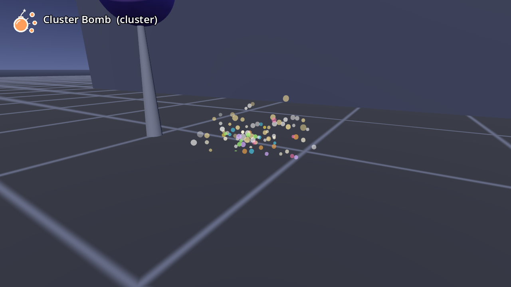

# AB-W-020 — القنبلة العنقودية (Cluster Bomb)

[← فهرس الأسلحة](../CATALOG.md)

| | |
|---|---|
|  |  |

| الحقل | القيمة |
|---|---|
| الرمز (code) | `AB-W-020` |
| الحزمة (pack) | مرحة (playful) |
| المعرّف (id) | `cluster` |
| الاسم | القنبلة العنقودية (Cluster Bomb) |
| الوصف | قنبلة مرحة تتفرق إلى ست قنابل صغيرة ملوّنة — *A playful bomb that scatters into six little colourful bombs* |
| العائلة (category) | منطقة تأثير/انفجار (area)، رشّ/متعدد (spray) |
| طريقة الإيصال (delivery) | قذيفة (projectile) |
| المسار (trajectory) | قوسي (ballistic) |
| نموذج الإصابة (hit) | انفجار/رذاذ (splash) |
| الدور (role) | هجوم (attack) |
| الفئة/الندرة (tier) | 3 متقدم (Advanced) |
| شرط الفتح الأصلي (origin unlock) | لا شرط (سلاح جديد في v1.2، لم يكن في اللعبة الأصلية) |
| الأيقونة | `addons/aboden_blaster/icons/cluster.png` (`cluster`) |
| الحالة (status) | مستقر (stable) |
| الإصدار (version) | v1.2 |

## السلوك

قنبلة مرحة تُقذف بقوس (10 م/ث، 0.8 g) وفتيلها يئز. بعد 0.7 ث (`life`) أو عند أول إصابة أو ارتطام تتفرق (`start_pop`) إلى 6 قنابل صغيرة (`pellets`) تنطلق للأعلى وحولها (مخروط 0.9–1.4 راديان حول الأعلى بسرعة 2.5 م/ث، مع 35% من سرعة القنبلة)، كل واحدة بلون من `CONFETTI_COLS`. كل قنبلة صغيرة تطير بالجاذبية حتى 0.9 ث وتنفجر عند أول ما تلمسه أو عند الأرض أو في نهاية عمرها، فتفرقع ما في 0.35 م (`bomblet.burst`، `pop_radius`) ويُحتسب `blaster_credit("bomblet", n)` (كحبات البن للدلّة).

**مشترك بين كل الأسلحة:** تُطلق بـ `fire(hand, origin, dir)` أو `fire_at(origin, target_point, hand)` (يصوّب الاتجاه نحو النقطة)؛ الفوهة 0.08 م أمام نقطة الإطلاق؛ لكل يد مؤقّت `cool` خاص بها؛ الطلقة الثلاثية (`shot_fan()` = 3) تدوّر الاتجاه ±0.11 راديان (`FAN_STEP`) حول المحور العمودي؛ كل الأطوال × `blaster_scale()`.

## المعاملات (`AbodenShotCatalog.SHOT_STYLE["cluster"]`)

| المعامل | القيمة | المعنى | الوحدة |
|---|---|---|---|
| `speed` | 10.0 | السرعة الابتدائية | م/ث |
| `grav` | 0.8 | الجاذبية (مضاعف g = 9.8 م/ث²؛ السالب يطفو) | × g |
| `life` | 0.7 | العمر الأقصى | ث |
| `r` | 0.04 | نصف قطر الإصابة | م |
| `cool` | 1.0 | أقل فاصل بين طلقتين لليد نفسها (معدل الإطلاق عند الضغط المستمر) | ث |
| `pellets` | 6 | عدد الأجسام في الطلقة (كرات، قطرات، قنابل صغيرة) | عدد |
| `sk` | 0.6 | قيمة k لصوت الإطلاق (الشدة/الطبقة) | — |
| `BOMBLET_POP_GAP` | 0.06 | أقل فاصل بين صوتي فرقعة | ث |
| `bomblet.*` | speed 2.5, grav 1.0, life 0.9, r 0.022, cool 0.0, burst 0.35, sk 0.8 | القنبلة الصغيرة (معاملات `SHOT_STYLE.bomblet`؛ `speed` سرعة تفرقها، `burst` انفجارها) | كما سبق |

## المظهر

- **المجسم:** قنبلة كروية لامعة بنفسجية ‎#6c3cff (0.04 م) بنقاط صفراء ‎#ffd23f، وعنق أصفر، وفتيل ‎#c9b38a بشرارة ‎#ffd34d ترتعش وترش شررًا، تتدحرج في الطيران.
- **القنابل الصغيرة:** كرات ملوّنة 0.022 م تُرسم مع الشرر.
- **انفجار الصغيرة (`bomblet_pop`):** وميض و12 شرارة بلونها، وصوت `cluster_pop` (لا يتكرر أسرع من كل 0.06 ث، `BOMBLET_POP_GAP`). **وميض الفوهة:** ‎#fff2c2.

## الأصوات

- swish — صفير (3 نسخ) ← **صوت الإطلاق**
- start_pop — فرقعة
- cluster_pop — فرقعة كرتونية وانفجار قصير لقنبلة صغيرة (3 نسخ، k 0.8؛ لا يتكرر أسرع من كل 0.06 ث)

الأصوات الجديدة في v1.2 مُركّبة بالكود (ضوضاء ومرشحات ومسارات تردد وأغلفة، بلا تسجيل) عبر `tools/gen_sounds.py`، بصيغة الملفات الأخرى (أحادية 22050 هرتز 16 بت).

## ملاحظات الضبط

`life` وقت الفتيل، و`pellets` العدد، و`bomblet.*` طيران الصغيرة وانفجارها. المعرّف `cluster` كما حُجز، ولا يتعارض مع `cluster` العسكري (AB-W-027): المعرّفات لكل حزمة في كتالوجها، والفريد هو الرمز.

## الاختبارات (`tests/run_tests.gd`)

- cluster: after its fuse it bursts into 6 bomblets
- cluster: each bomblet goes off where it lands
- cluster: its bomblets' blasts pop targets around it
- catalog: the playful "cluster" (AB-W-020) and the military one (AB-W-027) are told apart by code

## سجل التغييرات

| الإصدار | التاريخ | التغيير |
|---|---|---|
| v1.2 | 2026-10-23 | جديد: من الرموز المحجوزة إلى سلاح مستقر (أرقامه ومجسمه وأصواته وأيقونته واختباراته؛ انظر CHANGELOG). |
