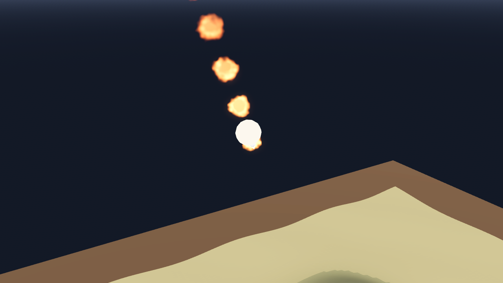

# AB-W-023 — صاروخ باليستي (Ballistic missile)

[← الحزمة العسكرية](../MILITARY.md) · [فهرس الأسلحة](../CATALOG.md)

| الحقل | القيمة |
|---|---|
| الرمز (code) | `AB-W-023` |
| الحزمة (pack) | عسكرية (military) |
| المعرّف (id) | `ballistic` |
| الاسم | صاروخ باليستي (Ballistic missile) |
| الاسم القصير | باليستي |
| مثال حقيقي (example) | Iskander |
| الوصف | قوس عالٍ وسقوط حاد بتوهج إعادة الدخول · انفجار قوي — *High arc and a steep, glowing re-entry; a heavy blast* |
| طريقة الإيصال (delivery) | قذيفة (projectile) |
| المسار (trajectory) | قوس عالٍ وعودة للغلاف (lofted) |
| نموذج الإصابة (hit) | انفجار/رذاذ (splash) |
| الدور (role) | هجوم (attack) |
| الفئة (tier) | 2 متوسط (Medium) |
| المطلق (launcher) | خلايا الإطلاق العمودي (`vls`) |
| احتمال الاعتراض في اللعبة (intercept) | 0.35 |
| الأيقونة | `addons/aboden_blaster/military/icons/ballistic.png` |
| الحالة (status) | مستقر (stable) |
| الإصدار (version) | v1.1 |

## المعاملات (`AbodenMilitaryCatalog.WEAPONS["ballistic"]`)

| المعامل | القيمة |
|---|---|
| `arc` | lofted |
| `flight` | [2.6, 3] |
| `blast` | 1.45 |
| `ejecta` | 90 |
| `cooldown` | 4 |
| `ammo` | 6 |
| `reload` | 8 |
| `glow` | true |
| `trail` | 0.016 |
| `length` | 0.0034 |
| `radius` | 0.0006 |
| `col` | `#d9dbd6` |

## السلوك

توهج إعادة الدخول.

قوس باليستي مغلق الشكل يصل إلى الهدف بالضبط بعد زمن الرحلة (يُختار من المسافة بين حدّي `flight`). إن كان للمضيف سقف قُصّر زمن الرحلة (قوس أخفض) حتى يبقى القوس كله تحته.

## المظهر

- **الصورة:** 
- **المجسم:** `AbodenMilitaryLooks.body()`، أسطوانة بمخروط مقدمة باللون `col`.
- **الأثر:** نفخة دخان كل `trail` ثانية باللون `trail_col`، وتوهج إعادة دخول ساخن في النزول.
- **الارتطام:** على اليابسة وميض وكرة نار وحلقة غبار وعمود دخان؛ في الماء عمود ماء ورذاذ ورغوة وتموجات.

## الأصوات

- `launch` عند الإطلاق، `boom` عند الانفجار على اليابسة، `thump` في الماء (عبر `military_sfx` أو المشغّل المدمج: whoosh و boom و splash).
