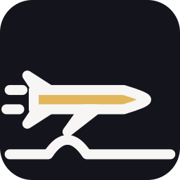
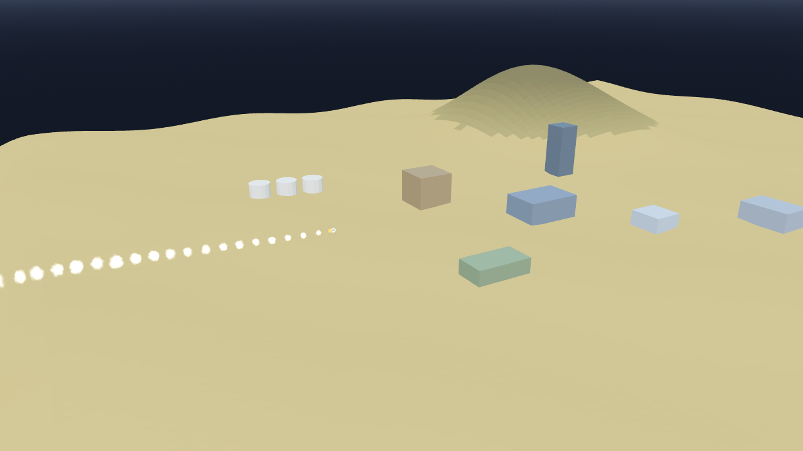

# AB-W-024 — صاروخ كروز (Cruise missile)

[← الحزمة العسكرية](../MILITARY.md) · [فهرس الأسلحة](../CATALOG.md)

| الحقل | القيمة |
|---|---|
| الرمز (code) | `AB-W-024` |
| الحزمة (pack) | عسكرية (military) |
| المعرّف (id) | `cruise` |
| الاسم | صاروخ كروز (Cruise missile) |
| الاسم القصير | كروز |
| مثال حقيقي (example) | Tomahawk |
| الوصف | يطير منخفضًا ويتبع التضاريس ويصعد قبل التلال · دقيق — *Flies low and follows the terrain, climbing before hills; precise* |
| طريقة الإيصال (delivery) | قذيفة (projectile) |
| المسار (trajectory) | نقاط مسار منخفضة (waypoints) |
| نموذج الإصابة (hit) | انفجار/رذاذ (splash) |
| الدور (role) | هجوم (attack) |
| الفئة (tier) | 1 سهل (Easy) |
| المطلق (launcher) | قواذف الصناديق المائلة (`box`) |
| احتمال الاعتراض في اللعبة (intercept) | 0.6 |
| الأيقونة | `addons/aboden_blaster/military/icons/cruise.png` |
| الحالة (status) | مستقر (stable) |
| الإصدار (version) | v1.2 |

## المعاملات (`AbodenMilitaryCatalog.WEAPONS["cruise"]`)

| المعامل | القيمة |
|---|---|
| `arc` | cruise |
| `flight` | [1.5, 3] |
| `speed` | 0.42 |
| `cruise_alt` | 0.006 |
| `blast` | 1 |
| `ejecta` | 60 |
| `cooldown` | 3 |
| `ammo` | 8 |
| `reload` | 6 |
| `glow` | false |
| `wings` | true |
| `trail` | 0.022 |
| `length` | 0.0028 |
| `radius` | 0.0004 |
| `col` | `#8c948c` |

## السلوك

—.

يخرج من القاذف وينزل بميل محدود إلى ارتفاع `cruise_alt` فوق التضاريس أو البحر، وينظر 4 سم أمامه ليصعد قبل التلال (أقصى ميل صعود 0.9)، ثم ينقضّ على الهدف في آخر 2.2 سم. إن كان التل أشد انحدارًا من حد الصعود اصطدم به وانفجر هناك (`crash` في المسار).

مع `military_roof` يصعد فوق المباني القائمة في طريقه في الوقت المناسب (برج أشد انحدارًا من أي تل) وينقضّ على هدف خلفها. وينفجر في نهاية مساره دائمًا حتى لو حفر المضيف الأرض هناك.

## المظهر

- **الصورة:** 
- **المجسم:** `AbodenMilitaryLooks.body()`، أسطوانة بمخروط مقدمة باللون `col`، وأجنحة.
- **الأثر:** نفخة دخان كل `trail` ثانية باللون `trail_col`.
- **الارتطام:** على اليابسة وميض وكرة نار وحلقة غبار وعمود دخان؛ في الماء عمود ماء ورذاذ ورغوة وتموجات.

## الأصوات

- `launch` عند الإطلاق، `boom` عند الانفجار على اليابسة، `thump` في الماء (عبر `military_sfx` أو المشغّل المدمج: whoosh و boom و splash).
