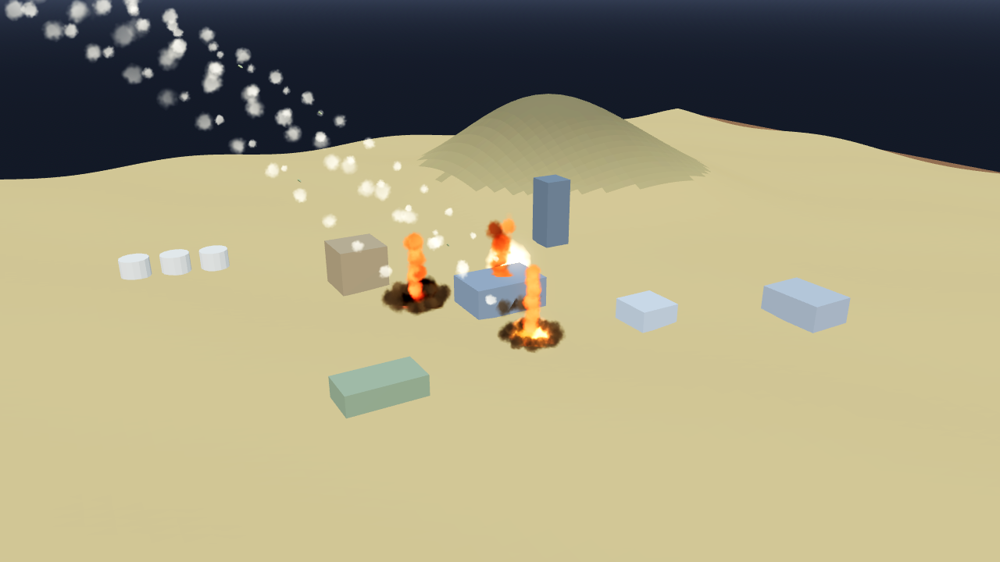

# AB-W-026 — راجمة صواريخ (MLRS rocket salvo)

[← الحزمة العسكرية](../MILITARY.md) · [فهرس الأسلحة](../CATALOG.md)

| الحقل | القيمة |
|---|---|
| الرمز (code) | `AB-W-026` |
| الحزمة (pack) | عسكرية (military) |
| المعرّف (id) | `mlrs` |
| الاسم | راجمة صواريخ (MLRS rocket salvo) |
| الاسم القصير | راجمة صواريخ |
| مثال حقيقي (example) | HIMARS |
| الوصف | 8 صواريخ متتالية كل 90 م.ث تتوزع حول الهدف — *8 rockets, one every 90 ms, scattered round the target* |
| طريقة الإيصال (delivery) | قذيفة (projectile) |
| المسار (trajectory) | قوسي (ballistic) |
| نموذج الإصابة (hit) | انفجار/رذاذ (splash) |
| الدور (role) | هجوم (attack) |
| الفئة (tier) | 1 سهل (Easy) |
| المطلق (launcher) | حاضنة الراجمة (`pod`) |
| احتمال الاعتراض في اللعبة (intercept) | 0.2 |
| الأيقونة | `addons/aboden_blaster/military/icons/mlrs.png` |
| الحالة (status) | مستقر (stable) |
| الإصدار (version) | v1.1 |

## المعاملات (`AbodenMilitaryCatalog.WEAPONS["mlrs"]`)

| المعامل | القيمة |
|---|---|
| `arc` | low |
| `flight` | [1.4, 1.7] |
| `blast` | 0.5 |
| `ejecta` | 14 |
| `cooldown` | 6 |
| `ammo` | 4 |
| `reload` | 9 |
| `salvo` | 8 |
| `spread` | 0.035 |
| `glow` | false |
| `trail` | 0.03 |
| `length` | 0.0016 |
| `radius` | 0.0003 |
| `col` | `#7a8561` |

## السلوك

دفعة 8 صواريخ (كل 90 م.ث) ضمن 0.035.

قوس باليستي منخفض وسريع إلى الهدف بالضبط (زمن الرحلة بين حدّي `flight`).

## المظهر

- **الصورة:** 
- **المجسم:** `AbodenMilitaryLooks.body()`، أسطوانة بمخروط مقدمة باللون `col`.
- **الأثر:** نفخة دخان كل `trail` ثانية باللون `trail_col`.
- **الارتطام:** على اليابسة وميض وكرة نار وحلقة غبار وعمود دخان؛ في الماء عمود ماء ورذاذ ورغوة وتموجات.

## الأصوات

- `launch` عند الإطلاق، `boom` عند الانفجار على اليابسة، `thump` في الماء (عبر `military_sfx` أو المشغّل المدمج: whoosh و boom و splash).
