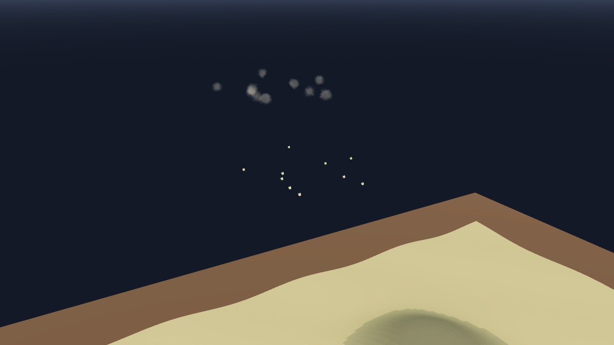

# AB-W-027 — صاروخ عنقودي (Cluster missile)

[← الحزمة العسكرية](../MILITARY.md) · [فهرس الأسلحة](../CATALOG.md)

| الحقل | القيمة |
|---|---|
| الرمز (code) | `AB-W-027` |
| الحزمة (pack) | عسكرية (military) |
| المعرّف (id) | `cluster` |
| الاسم | صاروخ عنقودي (Cluster missile) |
| الاسم القصير | عنقودي |
| مثال حقيقي (example) | ATACMS |
| الوصف | ينفتح في الجو ويطلق 10 قنيبلات تغطي منطقة الهدف — *Opens in the air and releases 10 bomblets over the target area* |
| طريقة الإيصال (delivery) | قذيفة (projectile) |
| المسار (trajectory) | قوس عالٍ وعودة للغلاف (lofted) |
| نموذج الإصابة (hit) | انفجار/رذاذ (splash) |
| الدور (role) | هجوم (attack) |
| الفئة (tier) | 2 متوسط (Medium) |
| المطلق (launcher) | خلايا الإطلاق العمودي (`vls`) |
| احتمال الاعتراض في اللعبة (intercept) | 0.35 |
| الأيقونة | `addons/aboden_blaster/military/icons/cluster.png` |
| الحالة (status) | مستقر (stable) |
| الإصدار (version) | v1.1 |

## المعاملات (`AbodenMilitaryCatalog.WEAPONS["cluster"]`)

| المعامل | القيمة |
|---|---|
| `arc` | lofted |
| `flight` | [2.6, 3] |
| `blast` | 0.45 |
| `ejecta` | 10 |
| `cooldown` | 7 |
| `ammo` | 3 |
| `reload` | 12 |
| `split` | 10 |
| `spread` | 0.045 |
| `glow` | false |
| `trail` | 0.018 |
| `length` | 0.003 |
| `radius` | 0.0006 |
| `col` | `#c7b880` |

## السلوك

10 قنيبلات عند 62٪ من الرحلة ضمن 0.045.

قوس باليستي مغلق الشكل يصل إلى الهدف بالضبط بعد زمن الرحلة (يُختار من المسافة بين حدّي `flight`). إن كان للمضيف سقف قُصّر زمن الرحلة (قوس أخفض) حتى يبقى القوس كله تحته.

## المظهر

- **الصورة:** 
- **المجسم:** `AbodenMilitaryLooks.body()`، أسطوانة بمخروط مقدمة باللون `col`.
- **الأثر:** نفخة دخان كل `trail` ثانية باللون `trail_col`.
- **الارتطام:** على اليابسة وميض وكرة نار وحلقة غبار وعمود دخان؛ في الماء عمود ماء ورذاذ ورغوة وتموجات.

## الأصوات

- `launch` عند الإطلاق، `boom` عند الانفجار على اليابسة، `thump` في الماء (عبر `military_sfx` أو المشغّل المدمج: whoosh و boom و splash).
