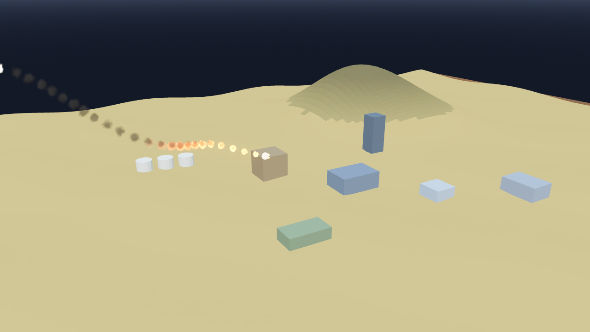

# AB-W-028 — صاروخ فرط صوتي (Hypersonic glide missile)

[← الحزمة العسكرية](../MILITARY.md) · [فهرس الأسلحة](../CATALOG.md)

| الحقل | القيمة |
|---|---|
| الرمز (code) | `AB-W-028` |
| الحزمة (pack) | عسكرية (military) |
| المعرّف (id) | `hypersonic` |
| الاسم | صاروخ فرط صوتي (Hypersonic glide missile) |
| الاسم القصير | فرط صوتي |
| مثال حقيقي (example) | Kinzhal |
| الوصف | يندفع إلى الأعلى ثم ينزلق منخفضًا متمايلًا يمينًا ويسارًا وينقضّ بتوهج · انفجار كبير — *Boosts up, then a low glide weaving side to side and a glowing terminal dive; a big blast* |
| طريقة الإيصال (delivery) | قذيفة (projectile) |
| المسار (trajectory) | قوس عالٍ وعودة للغلاف (lofted) |
| نموذج الإصابة (hit) | انفجار/رذاذ (splash) |
| الدور (role) | هجوم (attack) |
| الفئة (tier) | 3 متقدم (Advanced) |
| المطلق (launcher) | خلايا الإطلاق العمودي (`vls`) |
| احتمال الاعتراض في اللعبة (intercept) | 0.08 |
| الأيقونة | `addons/aboden_blaster/military/icons/hypersonic.png` |
| الحالة (status) | مستقر (stable) |
| الإصدار (version) | v1.2 |

## المعاملات (`AbodenMilitaryCatalog.WEAPONS["hypersonic"]`)

| المعامل | القيمة |
|---|---|
| `arc` | glide |
| `flight` | [1.1, 2.2] |
| `speed` | 1.1 |
| `blast` | 1.75 |
| `ejecta` | 90 |
| `cooldown` | 8 |
| `ammo` | 3 |
| `reload` | 14 |
| `glow` | true |
| `trail` | 0.012 |
| `length` | 0.003 |
| `radius` | 0.0006 |
| `col` | `#4d4d52` |

## السلوك

توهج إعادة الدخول.

مركبة انزلاق فرط صوتية: اندفاع حاد قصير إلى قمة القوس (خُمس الطريق)، ثم انزلاق طويل منخفض يتمايل يمينًا ويسارًا (منعطفان على شكل S يصعّبان الاعتراض) وهو ينزل نحو الهدف بعيدًا عن الأرض والمباني وتحت السقف، ثم انقضاض حاد في الثُمن الأخير بتوهج إعادة الدخول. ينفجر في نهاية مساره دائمًا.

## المظهر

- **الصورة:** 
- **المجسم:** `AbodenMilitaryLooks.body()`، أسطوانة بمخروط مقدمة باللون `col`.
- **الأثر:** نفخة دخان كل `trail` ثانية باللون `trail_col`، وتوهج إعادة دخول ساخن في النزول.
- **الارتطام:** على اليابسة وميض وكرة نار وحلقة غبار وعمود دخان؛ في الماء عمود ماء ورذاذ ورغوة وتموجات.

## الأصوات

- `launch` عند الإطلاق، `boom` عند الانفجار على اليابسة، `thump` في الماء (عبر `military_sfx` أو المشغّل المدمج: whoosh و boom و splash).
