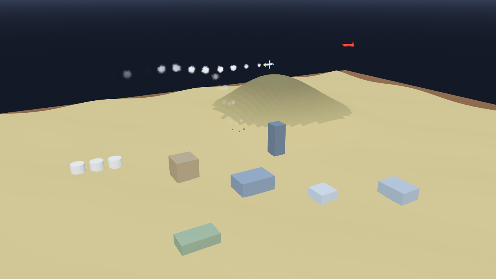

# AB-W-032 — طائرة هجومية (Strike jet)

[← الحزمة العسكرية](../MILITARY.md) · [فهرس الأسلحة](../CATALOG.md)

| الحقل | القيمة |
|---|---|
| الرمز (code) | `AB-W-032` |
| الحزمة (pack) | عسكرية (military) |
| المعرّف (id) | `jet` |
| الاسم | طائرة هجومية (Strike jet) |
| الاسم القصير | مقاتلة |
| مثال حقيقي (example) | F-15E |
| الوصف | تقلع من المنصة وتضرب الهدف بأربع قنابل ثم تعود وتهبط (الرحلة تطول) — *Takes off, drops 4 bombs on the target, flies home and lands (a long trip)* |
| طريقة الإيصال (delivery) | ضربة مُستدعاة (called) |
| المسار (trajectory) | نقاط مسار منخفضة (waypoints) |
| نموذج الإصابة (hit) | انفجار/رذاذ (splash) |
| الدور (role) | هجوم (attack) |
| الفئة (tier) | 3 متقدم (Advanced) |
| المطلق (launcher) | سطح الطيران (`deck`) |
| احتمال الاعتراض في اللعبة (intercept) | 0.4 |
| الأيقونة | `addons/aboden_blaster/military/icons/jet.png` |
| الحالة (status) | مستقر (stable) |
| الإصدار (version) | v1.1 |

## المعاملات (`AbodenMilitaryCatalog.WEAPONS["jet"]`)

| المعامل | القيمة |
|---|---|
| `arc` | sortie |
| `speed` | 0.14 |
| `cruise_alt` | 0.1 |
| `blast` | 0.8 |
| `ejecta` | 20 |
| `cooldown` | 2 |
| `ammo` | 2 |
| `reload` | 0 |
| `bombs` | 4 |
| `bomb` | jetbomb |
| `spread` | 0.012 |
| `glow` | false |
| `wings` | true |
| `trail` | 0.07 |
| `length` | 0.008 |
| `radius` | 0.0008 |
| `col` | `#9eadbd` |

## السلوك

4 قنابل (`jetbomb`) ضمن 0.012 قبل الهدف بـ 0.035 ثم تعود وتهبط.

تقلع من سطح الطيران، تصعد إلى `cruise_alt` فوق أعلى نقطتي الإقلاع والهدف، تطلق حمولتها (`jetbomb`) قبل الهدف بـ 0.035، تكمل وتستدير وتعود من الخلف لتهبط على السطح، فتعود ذخيرتها (`sortie_landed`). لا تلمس التضاريس، وتبقى تحت السقف إن وُجد. إن أسقطها المضيف (`shoot_down`) ضاعت (`sortie_lost`) ووصلت بديلة بعد 25 ث.

## المظهر

- **الصورة:** 
- **المجسم:** `AbodenMilitaryLooks.body()`، أسطوانة بمخروط مقدمة باللون `col`، وأجنحة، وذيل وموازن وقمرة.
- **الأثر:** نفخة دخان كل `trail` ثانية باللون `trail_col`.
- **الارتطام:** على اليابسة وميض وكرة نار وحلقة غبار وعمود دخان؛ في الماء عمود ماء ورذاذ ورغوة وتموجات.

## الأصوات

- `launch` عند الإطلاق، `boom` عند الانفجار على اليابسة، `thump` في الماء (عبر `military_sfx` أو المشغّل المدمج: whoosh و boom و splash).
