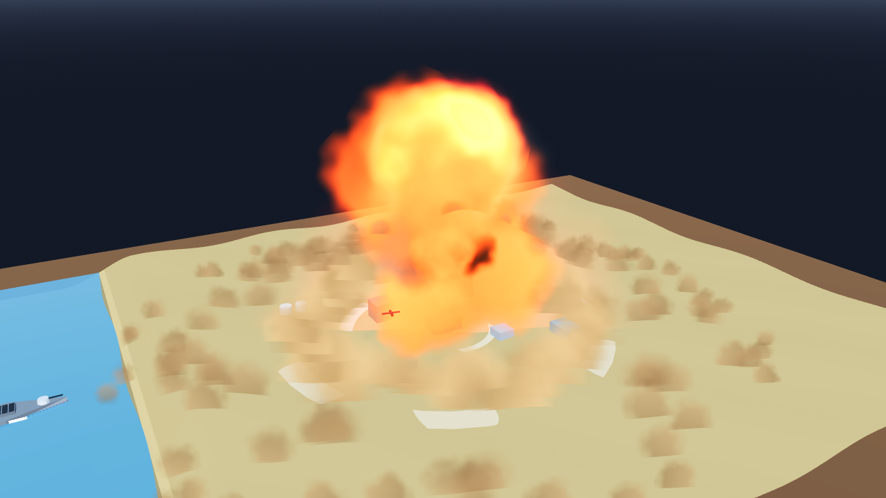

# AB-W-033 — قنبلة نووية (Nuclear test)

[← الحزمة العسكرية](../MILITARY.md) · [فهرس الأسلحة](../CATALOG.md)

| الحقل | القيمة |
|---|---|
| الرمز (code) | `AB-W-033` |
| الحزمة (pack) | عسكرية (military) |
| المعرّف (id) | `nuke` |
| الاسم | قنبلة نووية (Nuclear test) |
| الاسم القصير | قنبلة نووية |
| مثال حقيقي (example) | B61 |
| الوصف | تجربة نووية: وميض وكرة نار تصعد وفطر دخان وموجة صدمة تمتد بعيدًا · يدمر كل شيء في دائرة واسعة — *Nuclear test: flash, a rising fireball, a mushroom cloud and a shock wave running far out; destroys everything in a wide radius* |
| طريقة الإيصال (delivery) | قذيفة (projectile) |
| المسار (trajectory) | قوس عالٍ وعودة للغلاف (lofted) |
| نموذج الإصابة (hit) | انفجار بتناقص الضرر (falloff) |
| الدور (role) | هجوم (attack) |
| الفئة (tier) | 4 نخبة (Elite) |
| المطلق (launcher) | فتحة الصومعة النووية (`silo`) |
| احتمال الاعتراض في اللعبة (intercept) | 0.3 |
| الأيقونة | `addons/aboden_blaster/military/icons/nuke.png` |
| الحالة (status) | مستقر (stable) |
| الإصدار (version) | v1.2 |

## المعاملات (`AbodenMilitaryCatalog.WEAPONS["nuke"]`)

| المعامل | القيمة |
|---|---|
| `arc` | lofted |
| `flight` | [3.4, 3.8] |
| `blast` | 1 |
| `ejecta` | 20 |
| `cooldown` | 30 |
| `ammo` | 1 |
| `reload` | 90 |
| `nuke_r` | 0.16 |
| `wave_k` | 2.6 |
| `wave_t` | 3 |
| `cloud` | 1.9 |
| `glow` | true |
| `trail` | 0.012 |
| `length` | 0.0042 |
| `radius` | 0.0008 |
| `col` | `#ebebe6` |

## السلوك

نصف قطر التدمير 0.16، موجة صدمة إلى × 2.6 في 3 ث، توهج إعادة الدخول.

قوس باليستي مغلق الشكل يصل إلى الهدف بالضبط بعد زمن الرحلة (يُختار من المسافة بين حدّي `flight`). إن كان للمضيف سقف قُصّر زمن الرحلة (قوس أخفض) حتى يبقى القوس كله تحته.

عند الارتطام: تتابع نحو 10 ثوانٍ: وميض أبيض واسع، كرة نار بيضاء تصعد، ساق من الغبار والدخان تُسحب خلفها، قبعة فطر تتدحرج للخارج (تنتشر تحت السقف إن وُجد؛ في السماء المفتوحة أعلى وأوسع × `cloud`)، حلقة تكاثف قصيرة، موجة غبار قاعدية تجري على الأرض، وتموجات على الماء. `info.nuke_r` للمضيف ليدمر كل ما في الدائرة. ثم تمتد موجة الصدمة من `nuke_r` إلى `nuke_r × wave_k` (`info.wave_r`) في `wave_t` ثانية، سريعة أولًا ثم أبطأ، بجبهة غبار منخفضة؛ كل خطوة تبلّغ الحلقة التي اجتازتها (`shock_wave` و`military_shock`) ليُسقط المضيف ما فيها ويشعل الحرائق (`fx.fire_at`).

## المظهر

- **الصورة:** 
- **المجسم:** `AbodenMilitaryLooks.body()`، أسطوانة بمخروط مقدمة باللون `col`.
- **الأثر:** نفخة دخان كل `trail` ثانية باللون `trail_col`، وتوهج إعادة دخول ساخن في النزول.
- **الارتطام:** على اليابسة وميض وكرة نار وحلقة غبار وعمود دخان؛ في الماء عمود ماء ورذاذ ورغوة وتموجات.

## الأصوات

- `launch` عند الإطلاق، `boom` عند الانفجار على اليابسة، `thump` في الماء (عبر `military_sfx` أو المشغّل المدمج: whoosh و boom و splash).
