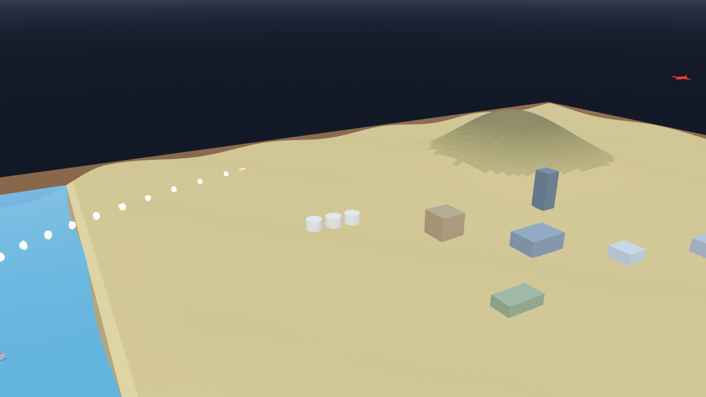

# AB-W-035 — صاروخ دفاع جوي (Anti-air missile)

[← الحزمة العسكرية](../MILITARY.md) · [فهرس الأسلحة](../CATALOG.md)

| الحقل | القيمة |
|---|---|
| الرمز (code) | `AB-W-035` |
| الحزمة (pack) | عسكرية (military) |
| المعرّف (id) | `aa` |
| الاسم | صاروخ دفاع جوي (Anti-air missile) |
| الاسم القصير | دفاع جوي |
| مثال حقيقي (example) | Patriot |
| الوصف | يلاحق هدفًا جويًا ويسقطه بانفجار في الجو · بلا هدف يطير إلى النقطة وينفجر هناك — *Homes on an air target and bursts on it; with none it flies to the point and bursts there* |
| طريقة الإيصال (delivery) | قذيفة (projectile) |
| المسار (trajectory) | اعتراض (intercept) |
| نموذج الإصابة (hit) | هدف واحد (single) |
| الدور (role) | دفاع/اعتراض (defence) |
| الفئة (tier) | 2 متوسط (Medium) |
| المطلق (launcher) | خلايا الإطلاق العمودي (`vls`) |
| احتمال الاعتراض في اللعبة (intercept) | 0 |
| الأيقونة | `addons/aboden_blaster/military/icons/aa.png` |
| الحالة (status) | مستقر (stable) |
| الإصدار (version) | v1.2 |

## المعاملات (`AbodenMilitaryCatalog.WEAPONS["aa"]`)

| المعامل | القيمة |
|---|---|
| `arc` | intercept |
| `flight` | [1, 1.4] |
| `speed` | 0.55 |
| `turn` | 6 |
| `kill_r` | 0.008 |
| `life` | 6 |
| `blast` | 0.4 |
| `ejecta` | 6 |
| `cooldown` | 2 |
| `ammo` | 6 |
| `reload` | 10 |
| `glow` | false |
| `trail` | 0.02 |
| `length` | 0.0024 |
| `radius` | 0.0003 |
| `col` | `#ebebe0` |

## السلوك

يلاحق هدفًا جويًا بسرعة 0.55 وينفجر على بعد 0.008 منه، يدمر نفسه بعد 6 ث.

يخرج عموديًا ثم يوجّه نفسه نحو هدفه الجوي (عقدة يعطيها المضيف عبر `military_air_target`، أو النقطة نفسها) بسرعة `speed` ومعدل انعطاف `turn`، تحت السقف. ينفجر في الجو على بعد `kill_r` من الهدف (`kind` = `air` و`info.target`)، أو على الأرض إن لاقاها أولًا، ويدمّر نفسه بعد `life` ثانية أو إن ضاع الهدف (`shot_down` بـ `by_host` = false). مسار المعاينة خط مستقيم إلى نقطة التصويب.

## المظهر

- **الصورة:** 
- **المجسم:** `AbodenMilitaryLooks.body()`، أسطوانة بمخروط مقدمة باللون `col`.
- **الأثر:** نفخة دخان كل `trail` ثانية باللون `trail_col`.
- **الارتطام:** في الجو وميض قصير وكرة نار صغيرة ودخان رمادي معلّق وشرر يتساقط (`fx.air_burst`)؛ على الأرض كالبقية.

## الأصوات

- `launch` عند الإطلاق، `boom` عند الانفجار على اليابسة، `thump` في الماء (عبر `military_sfx` أو المشغّل المدمج: whoosh و boom و splash).
