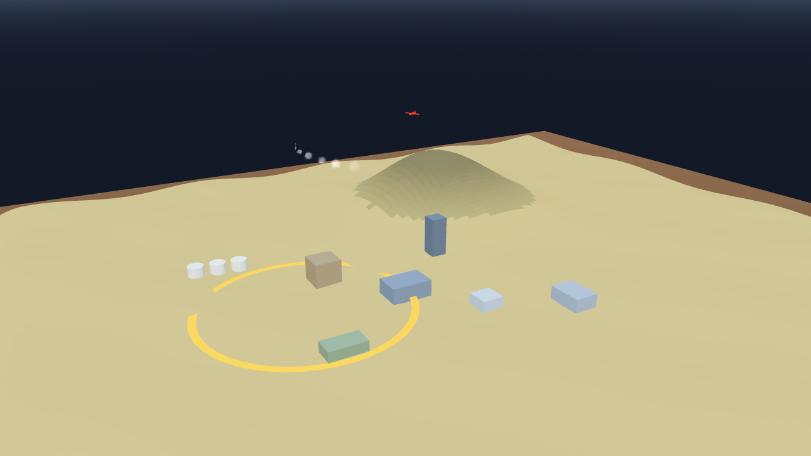

# AB-W-036 — طائرة استطلاع مسيّرة (Reconnaissance drone)

[← الحزمة العسكرية](../MILITARY.md) · [فهرس الأسلحة](../CATALOG.md)

| الحقل | القيمة |
|---|---|
| الرمز (code) | `AB-W-036` |
| الحزمة (pack) | عسكرية (military) |
| المعرّف (id) | `recon` |
| الاسم | طائرة استطلاع مسيّرة (Reconnaissance drone) |
| الاسم القصير | استطلاع |
| مثال حقيقي (example) | ScanEagle |
| الوصف | تقلع وتدور فوق المنطقة دورتين وتكشف ما تحتها ثم تعود وتهبط · لا تنفجر — *Takes off, circles the area twice reporting what it sees below, flies home and lands; no blast* |
| طريقة الإيصال (delivery) | ضربة مُستدعاة (called) |
| المسار (trajectory) | نقاط مسار منخفضة (waypoints) |
| نموذج الإصابة (hit) | كشف واستطلاع (scan) |
| الدور (role) | إسناد (support) |
| الفئة (tier) | 1 سهل (Easy) |
| المطلق (launcher) | سطح الطيران (`deck`) |
| احتمال الاعتراض في اللعبة (intercept) | 0.3 |
| الأيقونة | `addons/aboden_blaster/military/icons/recon.png` |
| الحالة (status) | مستقر (stable) |
| الإصدار (version) | v1.2 |

## المعاملات (`AbodenMilitaryCatalog.WEAPONS["recon"]`)

| المعامل | القيمة |
|---|---|
| `arc` | sortie |
| `speed` | 0.1 |
| `cruise_alt` | 0.11 |
| `blast` | 0 |
| `ejecta` | 0 |
| `cooldown` | 2 |
| `ammo` | 1 |
| `reload` | 0 |
| `bombs` | 0 |
| `orbit` | 0.07 |
| `scan_r` | 0.075 |
| `spread` | 0 |
| `glow` | false |
| `wings` | true |
| `trail` | 0.12 |
| `length` | 0.003 |
| `radius` | 0.0004 |
| `col` | `#c7ccd1` |

## السلوك

دورتان بنصف قطر 0.07 حول الهدف، تكشف ضمن 0.075، بلا انفجار، ثم تعود وتهبط.

تقلع من سطح الطيران، تصعد إلى `cruise_alt` فوق أعلى نقطتي الإقلاع والهدف، تدور حول الهدف دورتين بنصف قطر `orbit` وهي تبلّغ ما تراه تحتها ضمن `scan_r` كل 0.1 ث (`recon_scan` و`military_scan`؛ المضيف يقرر ما تكشفه)، ثم تستدير وتعود من الخلف لتهبط على السطح، فتعود ذخيرتها (`sortie_landed`). لا تلمس التضاريس، وتبقى تحت السقف إن وُجد. إن أسقطها المضيف (`shoot_down`) ضاعت (`sortie_lost`) ووصلت بديلة بعد 25 ث.

## المظهر

- **الصورة:** 
- **المجسم:** `AbodenMilitaryLooks.body()`، أسطوانة بمخروط مقدمة باللون `col`، وأجنحة.
- **الأثر:** نفخة دخان كل `trail` ثانية باللون `trail_col`.
- **الارتطام:** لا شيء (لا تنفجر).

## الأصوات

- `launch` عند الإطلاق، `boom` عند الانفجار على اليابسة، `thump` في الماء (عبر `military_sfx` أو المشغّل المدمج: whoosh و boom و splash).
