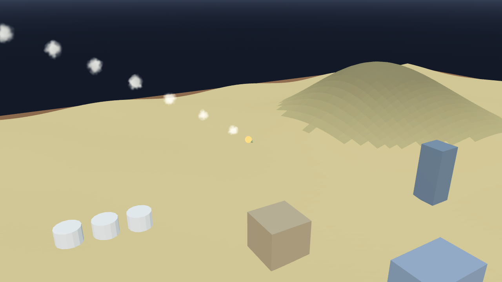

# AB-W-037 — صاروخ مضاد للدروع (Anti-tank missile)

[← الحزمة العسكرية](../MILITARY.md) · [فهرس الأسلحة](../CATALOG.md)

| الحقل | القيمة |
|---|---|
| الرمز (code) | `AB-W-037` |
| الحزمة (pack) | عسكرية (military) |
| المعرّف (id) | `atgm` |
| الاسم | صاروخ مضاد للدروع (Anti-tank missile) |
| الاسم القصير | مضاد للدروع |
| مثال حقيقي (example) | Javelin |
| الوصف | يعلو ثم ينقضّ على الدبابة من فوق · انفجار صغير قاتل للمدرعات — *Climbs and dives onto the tank from above; a small blast, deadly to armour* |
| طريقة الإيصال (delivery) | قذيفة (projectile) |
| المسار (trajectory) | من الأعلى (vertical) |
| نموذج الإصابة (hit) | هدف واحد (single) |
| الدور (role) | هجوم (attack) |
| الفئة (tier) | 1 سهل (Easy) |
| المطلق (launcher) | قواذف الصناديق المائلة (`box`) |
| احتمال الاعتراض في اللعبة (intercept) | 0 |
| الأيقونة | `addons/aboden_blaster/military/icons/atgm.png` |
| الحالة (status) | مستقر (stable) |
| الإصدار (version) | v1.2 |

## المعاملات (`AbodenMilitaryCatalog.WEAPONS["atgm"]`)

| المعامل | القيمة |
|---|---|
| `arc` | lofted |
| `flight` | [1.3, 1.6] |
| `blast` | 0.32 |
| `armor_k` | 2.6 |
| `ejecta` | 6 |
| `cooldown` | 1.5 |
| `ammo` | 6 |
| `reload` | 6 |
| `glow` | false |
| `trail` | 0.02 |
| `length` | 0.0016 |
| `radius` | 0.0003 |
| `col` | `#6b7a57` |

## السلوك

يعطّل الدروع ضمن نصف قطر الانفجار × 2.6.

قوس باليستي مغلق الشكل يصل إلى الهدف بالضبط بعد زمن الرحلة (يُختار من المسافة بين حدّي `flight`). إن كان للمضيف سقف قُصّر زمن الرحلة (قوس أخفض) حتى يبقى القوس كله تحته.

## المظهر

- **الصورة:** 
- **المجسم:** `AbodenMilitaryLooks.body()`، أسطوانة بمخروط مقدمة باللون `col`.
- **الأثر:** نفخة دخان كل `trail` ثانية باللون `trail_col`.
- **الارتطام:** على اليابسة وميض وكرة نار وحلقة غبار وعمود دخان؛ في الماء عمود ماء ورذاذ ورغوة وتموجات.

## الأصوات

- `launch` عند الإطلاق، `boom` عند الانفجار على اليابسة، `thump` في الماء (عبر `military_sfx` أو المشغّل المدمج: whoosh و boom و splash).
