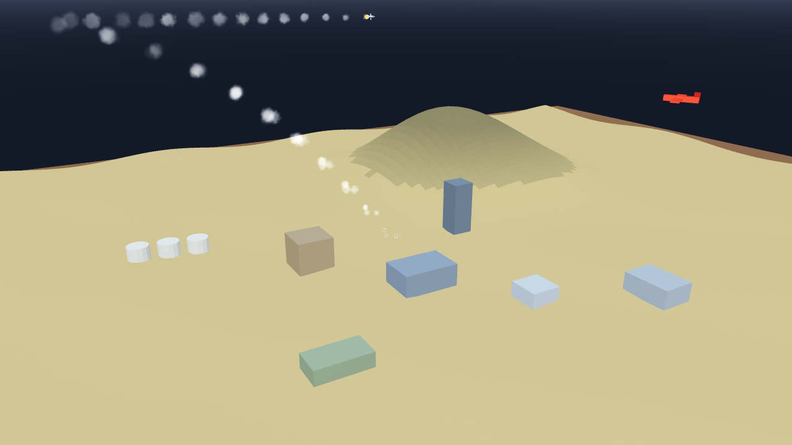

# AB-W-038 — قنابل انزلاقية (Glide bombs)

[← الحزمة العسكرية](../MILITARY.md) · [فهرس الأسلحة](../CATALOG.md)

| الحقل | القيمة |
|---|---|
| الرمز (code) | `AB-W-038` |
| الحزمة (pack) | عسكرية (military) |
| المعرّف (id) | `glide` |
| الاسم | قنابل انزلاقية (Glide bombs) |
| الاسم القصير | قنابل انزلاقية |
| مثال حقيقي (example) | GBU-39 |
| الوصف | تطلقها طائرة من بعيد فتنزلق بأجنحتها إلى الهدف · 4 قنابل ثم تعود الطائرة — *A jet releases 4 of them far out and they glide in on their wings; the jet flies home* |
| طريقة الإيصال (delivery) | ضربة مُستدعاة (called) |
| المسار (trajectory) | نقاط مسار منخفضة (waypoints) |
| نموذج الإصابة (hit) | انفجار/رذاذ (splash) |
| الدور (role) | هجوم (attack) |
| الفئة (tier) | 2 متوسط (Medium) |
| المطلق (launcher) | سطح الطيران (`deck`) |
| احتمال الاعتراض في اللعبة (intercept) | 0.3 |
| الأيقونة | `addons/aboden_blaster/military/icons/glide.png` |
| الحالة (status) | مستقر (stable) |
| الإصدار (version) | v1.2 |

## المعاملات (`AbodenMilitaryCatalog.WEAPONS["glide"]`)

| المعامل | القيمة |
|---|---|
| `arc` | sortie |
| `speed` | 0.15 |
| `cruise_alt` | 0.13 |
| `blast` | 0.7 |
| `ejecta` | 16 |
| `cooldown` | 2 |
| `ammo` | 2 |
| `reload` | 0 |
| `bombs` | 4 |
| `bomb` | gbomb |
| `release_lead` | 0.16 |
| `spread` | 0.014 |
| `glow` | false |
| `wings` | true |
| `trail` | 0.05 |
| `length` | 0.0034 |
| `radius` | 0.0005 |
| `col` | `#8c99a8` |

## السلوك

4 قنابل انزلاقية (`gbomb`) ضمن 0.014 قبل الهدف بـ 0.16 ثم تعود وتهبط.

تقلع من سطح الطيران، تصعد إلى `cruise_alt` فوق أعلى نقطتي الإقلاع والهدف، تطلق حمولتها (`gbomb`) قبل الهدف بـ 0.16، تكمل وتستدير وتعود من الخلف لتهبط على السطح، فتعود ذخيرتها (`sortie_landed`). لا تلمس التضاريس، وتبقى تحت السقف إن وُجد. إن أسقطها المضيف (`shoot_down`) ضاعت (`sortie_lost`) ووصلت بديلة بعد 25 ث.

القنابل الانزلاقية تنفصل بعيدًا (16 سم قبل الهدف) وتنزلق بأجنحتها: مستوية أولًا ثم أشد انحدارًا في النهاية، بسرعة 0.2 و/ث.

## المظهر

- **الصورة:** 
- **المجسم:** `AbodenMilitaryLooks.body()`، أسطوانة بمخروط مقدمة باللون `col`، وأجنحة، وذيل وموازن وقمرة.
- **الأثر:** نفخة دخان كل `trail` ثانية باللون `trail_col`.
- **الارتطام:** على اليابسة وميض وكرة نار وحلقة غبار وعمود دخان؛ في الماء عمود ماء ورذاذ ورغوة وتموجات.

## الأصوات

- `launch` عند الإطلاق، `boom` عند الانفجار على اليابسة، `thump` في الماء (عبر `military_sfx` أو المشغّل المدمج: whoosh و boom و splash).
