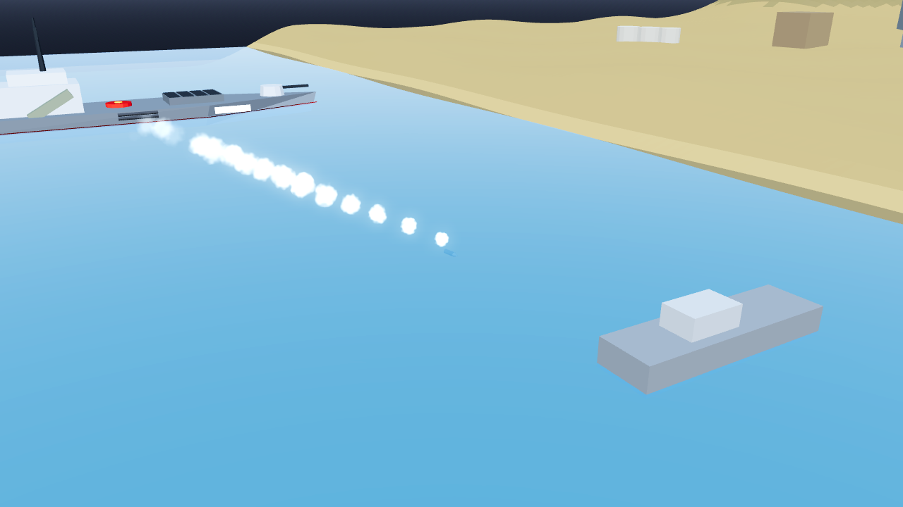

# AB-W-039 — طوربيد (Torpedo)

[← الحزمة العسكرية](../MILITARY.md) · [فهرس الأسلحة](../CATALOG.md)

| الحقل | القيمة |
|---|---|
| الرمز (code) | `AB-W-039` |
| الحزمة (pack) | عسكرية (military) |
| المعرّف (id) | `torpedo` |
| الاسم | طوربيد (Torpedo) |
| الاسم القصير | طوربيد |
| مثال حقيقي (example) | Mk 48 |
| الوصف | يُلقى من جانب السفينة ويجري تحت سطح الماء إلى الهدف · يتوقف وينفجر عند الشاطئ — *Dropped over the side, it runs under the surface to the target; stops and goes off at the shore* |
| طريقة الإيصال (delivery) | قذيفة (projectile) |
| المسار (trajectory) | مستقيم (straight) |
| نموذج الإصابة (hit) | انفجار/رذاذ (splash) |
| الدور (role) | هجوم (attack) |
| الفئة (tier) | 2 متوسط (Medium) |
| المطلق (launcher) | أنبوب الطوربيد (`tube`) |
| احتمال الاعتراض في اللعبة (intercept) | 0 |
| الأيقونة | `addons/aboden_blaster/military/icons/torpedo.png` |
| الحالة (status) | مستقر (stable) |
| الإصدار (version) | v1.2 |

## المعاملات (`AbodenMilitaryCatalog.WEAPONS["torpedo"]`)

| المعامل | القيمة |
|---|---|
| `arc` | torpedo |
| `flight` | [0.8, 9] |
| `speed` | 0.16 |
| `blast` | 1.35 |
| `ejecta` | 0 |
| `cooldown` | 4 |
| `ammo` | 4 |
| `reload` | 10 |
| `glow` | false |
| `trail` | 0.05 |
| `length` | 0.0032 |
| `radius` | 0.0004 |
| `col` | `#40474d` |

## السلوك

يجري تحت السطح بـ 1.6 مم ويتوقف عند الشاطئ.

يُلقى من أنبوب على جانب السفينة وينزل في أول نقطتين إلى 1.6 مم تحت سطح الماء ويجري مستقيمًا إلى الهدف، وأثره رغوة على السطح فوقه. لا يخرج من الماء: إن كان الهدف على اليابسة توقف وانفجر عند الشاطئ (أول نقطة بلا ماء، من `military_water_depth`). بلا `military_water_depth` تُحسب الطاولة كلها ماءً. عند سفينة في الماء `kind` = `water` والمضيف يقرر الضرر.

## المظهر

- **الصورة:** 
- **المجسم:** `AbodenMilitaryLooks.body()`، أسطوانة بمخروط مقدمة باللون `col`.
- **الأثر:** رغوة على سطح الماء فوقه كل `trail` ثانية باللون `trail_col`.
- **الارتطام:** على اليابسة وميض وكرة نار وحلقة غبار وعمود دخان؛ في الماء عمود ماء ورذاذ ورغوة وتموجات.

## الأصوات

- `launch` عند الإطلاق، `boom` عند الانفجار على اليابسة، `thump` في الماء (عبر `military_sfx` أو المشغّل المدمج: whoosh و boom و splash).
