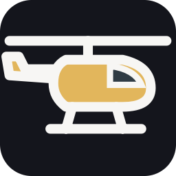
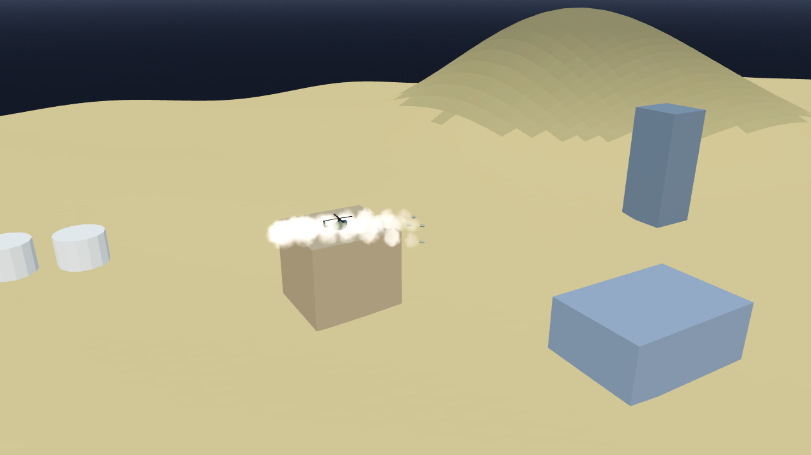

# AB-W-040 — مروحية هجومية (Attack helicopter)

[← الحزمة العسكرية](../MILITARY.md) · [فهرس الأسلحة](../CATALOG.md)

| الحقل | القيمة |
|---|---|
| الرمز (code) | `AB-W-040` |
| الحزمة (pack) | عسكرية (military) |
| المعرّف (id) | `heli` |
| الاسم | مروحية هجومية (Attack helicopter) |
| الاسم القصير | مروحية |
| مثال حقيقي (example) | AH-64 Apache |
| الوصف | منخفضة وبطيئة · رشقة 6 صواريخ من مسافة ثم تعود وتهبط — *Low and slow; a volley of 6 rockets from stand-off range, then home to land* |
| طريقة الإيصال (delivery) | ضربة مُستدعاة (called) |
| المسار (trajectory) | نقاط مسار منخفضة (waypoints) |
| نموذج الإصابة (hit) | انفجار/رذاذ (splash) |
| الدور (role) | هجوم (attack) |
| الفئة (tier) | 3 متقدم (Advanced) |
| المطلق (launcher) | سطح الطيران (`deck`) |
| احتمال الاعتراض في اللعبة (intercept) | 0.35 |
| الأيقونة | `addons/aboden_blaster/military/icons/heli.png` |
| الحالة (status) | مستقر (stable) |
| الإصدار (version) | v1.2 |

## المعاملات (`AbodenMilitaryCatalog.WEAPONS["heli"]`)

| المعامل | القيمة |
|---|---|
| `arc` | sortie |
| `speed` | 0.09 |
| `cruise_alt` | 0.035 |
| `blast` | 0.45 |
| `ejecta` | 10 |
| `cooldown` | 2 |
| `ammo` | 2 |
| `reload` | 0 |
| `bombs` | 6 |
| `bomb` | hrocket |
| `release_lead` | 0.07 |
| `spread` | 0.016 |
| `glow` | false |
| `trail` | 0.2 |
| `length` | 0.0034 |
| `radius` | 0.0006 |
| `col` | `#57614d` |

## السلوك

6 صواريخ (`hrocket`) ضمن 0.016 قبل الهدف بـ 0.07 ثم تعود وتهبط.

تقلع من سطح الطيران، تصعد إلى `cruise_alt` فوق أعلى نقطتي الإقلاع والهدف، تطلق حمولتها (`hrocket`) قبل الهدف بـ 0.07، تكمل وتستدير وتعود من الخلف لتهبط على السطح، فتعود ذخيرتها (`sortie_landed`). لا تلمس التضاريس، وتبقى تحت السقف إن وُجد. إن أسقطها المضيف (`shoot_down`) ضاعت (`sortie_lost`) ووصلت بديلة بعد 25 ث.

الصواريخ تنطلق رشقة واحدة من مسافة 7 سم بقوس منخفض سريع (0.4–0.55 ث)، وكل منها مضاد للدروع (`armor_r`).

## المظهر

- **الصورة:** 
- **المجسم:** `AbodenMilitaryLooks.body()`، جسم مروحية نحيل بقمرة أمامية وذراع ذيل وزعنفة وجناحين قصيرين بحاضنتي صواريخ ومروحة بشفرتين، باللون `col`.
- **الأثر:** بلا أثر دخان.
- **الارتطام:** على اليابسة وميض وكرة نار وحلقة غبار وعمود دخان؛ في الماء عمود ماء ورذاذ ورغوة وتموجات.

## الأصوات

- `launch` عند الإطلاق، `boom` عند الانفجار على اليابسة، `thump` في الماء (عبر `military_sfx` أو المشغّل المدمج: whoosh و boom و splash).
